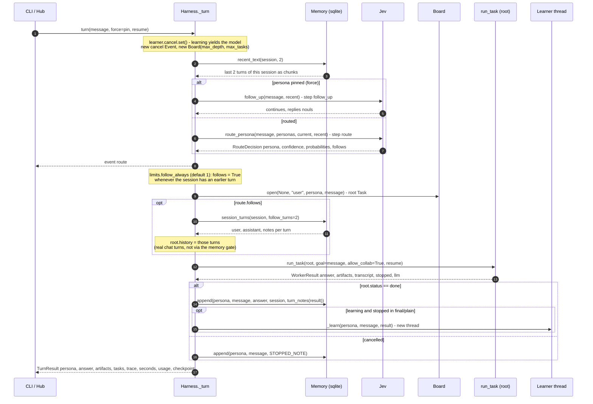
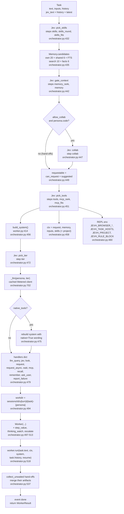
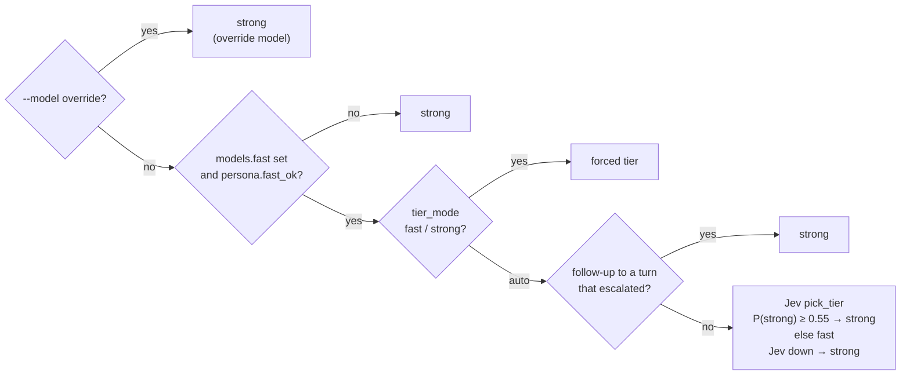

# 01 · Turn and task setup

A **turn** is one user message. `Harness.turn` (`orchestrator.py:240`) sets up cancellation and
the thread-local tags, then `_turn` (`orchestrator.py:251`) does the work. Every task in the turn,
whether the root or a hand-off, goes through `run_task` (`orchestrator.py:428`). `run_task` asks
Jev five questions and assembles what the worker will see.

## The turn loop



| Step | Code | Data |
|---|---|---|
| Recent context | `orchestrator.py:255`, `memory.py:132` | the session's last 2 turns, each clipped to 900 chars |
| Routing | `orchestrator.py:265`, `jev.py:165` | `{latest_request, recent_conversation}` → `RouteDecision` |
| Root task | `orchestrator.py:269`, `bus.py:91` | `Task(id, parent=None, requester="user", to, text)` |
| Follow-up history | `orchestrator.py:273`, `memory.py:137` | `[(user, assistant, notes)]` × `limits.follow_turns` |
| Memory write | `orchestrator.py:278`, `memory.py:111` | turn + `turn_notes()` (code run and outputs, 2k chars) |
| Learning | `orchestrator.py:280`, `:398` | runs on its own thread with the model that just ran the task |
| Result | `orchestrator.py:284` | `TurnResult` incl. `usage.summary(session, turn)` and a checkpoint path if resumable |

**Routing rule** (`jev.py:165-195`): if the message follows up (`continues ≥ 0.25` or
`replies ≥ 0.40`) and the Choice isn't confident (`< route 0.45`), stay with the current persona.
Otherwise take the pick if its confidence is `≥ 0.45`. Otherwise stay if `continues ≥ stick 0.55`.
Otherwise use `default_persona`. If Jev is down, `_safe` (`orchestrator.py:728`) falls back to the
current or default persona.

**Every turn carries the last ones** (`limits.follow_always: 1`, the default since 2026-10-23): Jev's `follows` still
steers the persona choice above, but the last `follow_turns` turns (with the previous turn's folder and REPL state)
go along whatever it says. On light Jev (Laya), routing read "could you also give me unlimited coins? but yeah go
ahead and continue" as a new topic (flagged 2026-10-22), and the worker, with nothing of the game it had been modding,
went off to start Docker. On 68 real hand-labelled pairs the old rule dropped about 4% of follow-ups, and those were
the turns the user flagged; it already carried most new topics anyway. The cost is a couple of turns of context on a new
topic. `follow_always: 0` puts Jev's call back. Live (2026-10-24, Strata + Laya, `evals/bench/flags_12_15_17.py`, 3 repeats):
two-turn follow-ups 15/15 new vs 13/15 old, new topics after a task 8/9 vs 7/9 (one new-arm answer offered to go back to
the earlier topic at its end), about 3k more input tokens on a new topic's turn.

## Task setup: what `run_task` builds



### The system prompt (`build_system`, `worker.py:414`)

Assembled in this order. Only the parts Jev picked are included:

1. `persona.system_prompt` + today's date (date only, so a local model's prompt cache holds all day).
2. `## Environment`: Python version, OS, the working folder, and which common packages import.
3. `## How you work` (`HOW_YOU_WORK`, `worker.py:334`): the REPL guide. Two wordings: native tool
   calls (`NATIVE_ACT`) or fenced ```` ```python ```` blocks (`TEXT_ACT`).
4. `REQUEST_GUIDE` + the roster of `requestable` personas, when there are any.
5. `## Tools in your REPL`: only the guides Jev picked (`tools/__init__.py` `TOOLS[name].guide`),
   with live notes (nango: which accounts are connected). The rest of the persona's tools are named
   in one line: "Also importable…".
6. `## MCP tools`: signatures of the MCP tools Jev picked.
7. Jev's collaborator suggestion line.
8. `## Skill: name`: the picked skill's body. Past 6,000 chars only the head goes in, and the full
   text sits in `ctx['skills'][name]`. Learned drafts are marked as unreviewed.

### What reaches the worker, and how

| Data | Channel | Size rule |
|---|---|---|
| The request | the task message | as is, plus `(In your REPL: …)` listing ctx keys and sizes (`describe_ctx`, `worker.py:398`) |
| Follow-up turns | real `user` / `assistant` messages before the task | 3,000 chars per reply, plus 2,500 chars of work notes |
| Memory snippets Jev kept | `ctx['memory']` in the REPL, not the prompt | ≤ `max_memory_chunks` (4) |
| Hand-off inputs | `ctx['inputs']` (artifact paths) | paths only |
| Skill full text | `ctx['skills']` | full |
| Project path | `ctx['project']` + `JEVH_PROJECT` env | only for personas with the `project` tool, and only while a project is open |

A plain chat persona (`code: false`) has no REPL. `Worker._chat` (`worker.py:1123`) puts the kept
memory and the inputs straight into the user message and makes one model call.

## Model tier and client (`_pick_tier`, `_llm`, `_model_cfg`)



`_llm` (`orchestrator.py:702`) caches one client per `(persona, tier)`. Each is wrapped in
`Metered` (`usage.py:132`), which records every call, and gets an `on_progress` hook that emits
`progress` events (token counts while streaming). `_model_cfg` (`orchestrator.py:715`) swaps in
`models.fast`, or `models.strong` from `config.local.yaml`, keeping the persona's sampling settings.
