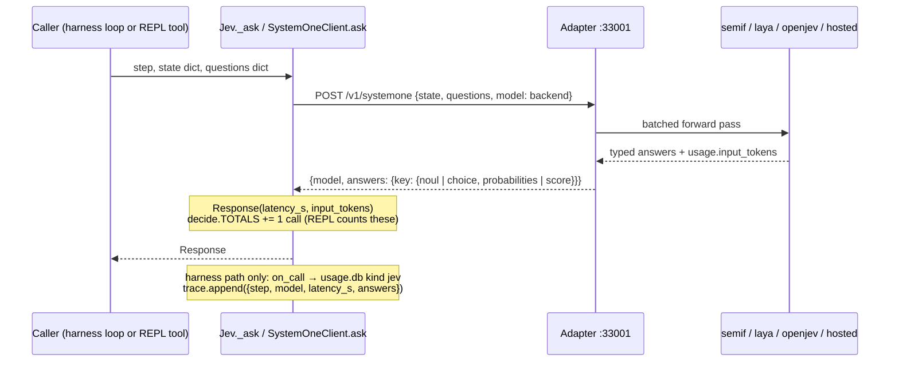

# 02 · Jev decisions

Every decision is one `POST /v1/systemone` with `{state, questions, model}` (`decide.py:100`).
The adapter answers each question: a `noul` returns P(yes), a `choice` returns a probability per
option, and a `score` returns a level. The client retries 408/429/5xx and connection errors twice,
with 2s and 4s backoff (`decide.py:124`).

**Choices bigger than the backend's cap.** semif takes 2 to 16 options per choice. On the harness
side, `Jev.choice_probs` (`jev.py:230`) splits a big set into balanced rounds (step `<name>_round`),
keeps the top of each round, and asks a final round. "None of these" options join only the final
round. In the tools, `_pick.choose` (`tools/_pick.py:41`) does the same but sends all round
questions in one request. The hosted Jev (`tools_jev: cloud`) takes up to 240 options per choice.

**Two-stage pick** (skills, memory, MCP tools, passages): one relative **choice** ranks everything
in one pass, then a yes/no **noul** runs only on the top 3 or 4. Nouls on every candidate were
slower and less accurate (see README "Measured").

## Harness-side decisions (recorded as kind `jev`)

| Step | Where | State sent | Questions | Rule (config `thresholds`) | If Jev is down |
|---|---|---|---|---|---|
| `route` | `jev.py:165` | `latest_request`, `recent_conversation` (1.5k) | choice over persona descriptions; `continues`, `replies` nouls | see [01](01-turn.md#the-turn-loop): `route .45`, `stick .55`, `follow_topic .25`, `follow_reply .40` | current or default persona |
| `follow_up` | `jev.py:200` | same, pinned persona | `continues`, `replies` | follows if either passes | not a follow-up |
| `skills`, `skills_round` | `jev.py:208` | `latest_request`, `assistant` | choice over allowed skills + `none_of_these` | P(none) ≥ `skill_none_veto .90` → no skill | no skills |
| `skills_fits` | `jev.py:221` | same | noul "describes how to do this task" on top 3 | leader ≥ `skill_override .90` loads; else rank P×fits, fits ≥ `skill_fits .08`; max `limits.max_skills` 1 | — |
| `memory_rank`, `memory_rank_round` | `jev.py:282` | `latest_request` | choice over snippets (300 chars) + none; only when > 4 candidates | top 4 go on | no memory |
| `memory` | `jev.py:294` | `latest_request` | noul "refers to or depends on this snippet" (800 chars) | ≥ `memory .20`, cap `max_memory_chunks` 4 | — |
| `collab` | `jev.py:312` | `latest_request`, `lead_assistant` | score complexity (3 levels) + noul `needs_<persona>` per other persona | complexity < 0.5 → nobody; else ≥ `collab .60` | nobody |
| `tools` | `jev.py:257` | `latest_request` | noul per tool the persona lists (`TOOLS[t].description`) | ≥ `tool .65` | all guides |
| `mcp_rank`, `mcp_fits` | `jev.py:267` | `latest_request` | choice over the MCP catalog + none, then noul on top 3 | fits ≥ `mcp_fits .50`, max `max_mcp_tools` 3 | all guides |
| `tier` | `jev.py:301` | `task` (task text only, on purpose) | choice fast / strong | P(strong) ≥ `tier_strong .55` → strong | strong |
| `approve` | `jev.py:336` | `requesting_assistant`, `target`, `task` | `in_scope`, `necessary` nouls | both ≥ `approve .50` | approved |
| `worker_jev` | `orchestrator.py:460` | whatever the worker passes to `jev()` | whatever the worker asks | the worker decides | error in the worker's code |
| `memory_rank` / `memory` via `recall()` | `orchestrator.py:658` | the worker's query | same as the memory gate, over FTS turns + facts | same | first k chunks |
| `progress` | `orchestrator.py:605` | `request` (1.5k), `work_log` (last 4k) | `circles` noul | ≥ `stall .60` → a strike | no check |
| `compact` | `orchestrator.py:612` | `task`, `now` (2k), `step` (4.5k) | `info` noul per old step | ≥ `compact_keep .80` → keep in full | notes only |
| `thinking_watch` | `orchestrator.py:622` | `task`, `thinking` (last 2.5k) | `testable`, `stuck`, `checking` | testable ≥ `testable .55`, or stuck − checking > `searching .25` → pause | no pause |
| `verify` | `verify.py:223` | `request`, `answer`, `artifacts`, `work_log` (3.5k) | `claims`, `delivers`, `honest`, `accurate` | see [07](07-final-gate.md) | file and test checks only |
| `risk` | `verify.py:341` | `request`, `file`, `change` | `risky` per changed file | ≥ `review_risk .65` → full review | review everything |
| `severity` | `verify.py:376` | `request`, `file`, `change` | `severe` | ≥ `review_severe .20` (or a severe-looking regex) → strong reviewer | strong reviewer |
| `learn_fact` | `learn.py:190` | `user_message`, `assistant_reply` | `fact` | ≥ `fact .88` → model writes facts | skipped |
| `learn_same_fact` | `learn.py:206` | `new_fact`, `old_facts` | one noul per old fact | ≥ `same_fact .50` → retire old | — |
| `learn_skill` | `learn.py:221` | `task`, `work_log` | `skill` | ≥ `learn_skill .50` → write skill or lessons | skipped |

`_safe` (`orchestrator.py:711`) wraps the harness decisions made before and around a task. On
`SystemOneError` it emits `jev_error` and returns the fallback shown above, so a dead adapter
degrades the harness instead of crashing it.

## Tool-side decisions (inside the REPL, recorded as kind `jev_tools`)

| Tool | Where | Questions | Rule |
|---|---|---|---|
| `browser.do` target | `tools/browser.py:837` | choice `Q_TARGET` over the page's elements + `scroll`, `back`, `none`; extras `done`, `error` (after an action), `blocked` + `login` (before one) | done ≥ .9 → done; error ≥ .7; blocked ≥ .85; login ≥ .7; best < .2 → ambiguous |
| `browser.do` groups | `tools/browser.py:1032` | choice `Q_GROUP` when elements + pseudo > cap, then `Q_TARGET` on 1–2 groups | groups up to 85% of the mass |
| `browser.do` value | `tools/browser.py:1175` | choice `Q_VALUE`: which given value goes in this field | argmax |
| `browser.do` dropdown | `tools/browser.py:1186` | choice over the dropdown's options | argmax |
| `browser.do` button | `tools/browser.py:1194` | `wanted`, `irreversible` (unless the label decides), `pending` | wanted ≥ .4; irreversible ≥ .6 → needs_confirmation; pending ≥ .8 → not ready |
| `browser.click` | `tools/browser.py:699` | `irreversible` | ≥ .6 |
| `browser.test` | `tools/browser.py:792` | `shows`, `holds` on the final page | both ≥ .55 / .6 |
| `browser.read`, `web.read` | `tools/_pick.py:100` | choice over passages, noul on top 3 | noul ≥ .3 (keep at least one) |
| `web.ask` | `tools/web.py:135` | choice over search results, then passages per page | best first, one page per site |
| `project.find`, `find_files` | `tools/project.py:348`, `:367` | choice over snippets / files after a keyword prefilter | best first |
| rule enforcer | `tools/rules.py:125` | `breaks` noul per rule in scope (max 12) | ≥ `rule_block .80` → edit blocked |

These tools use `client_from_env()` (`tools/_pick.py:19`): the local adapter at `JEVH_JEV_URL`
(cap 16), or the hosted API when `JEVH_TOOLS_JEV=cloud` (cap 240, page text leaves the machine).
