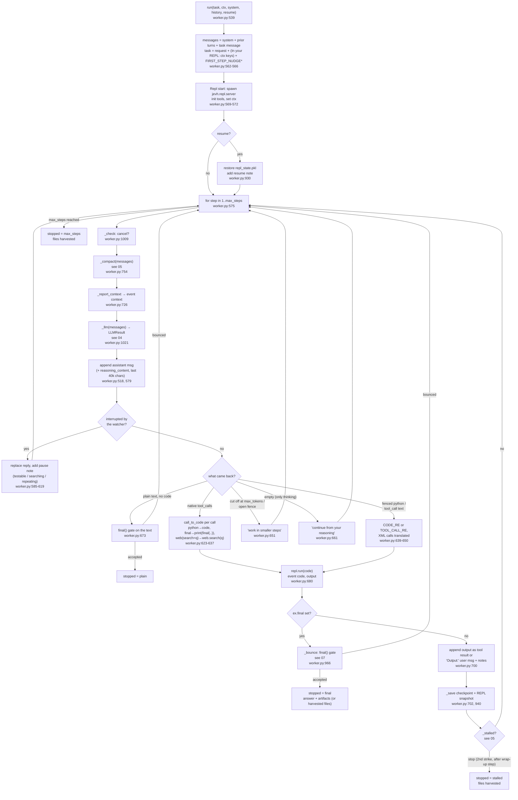
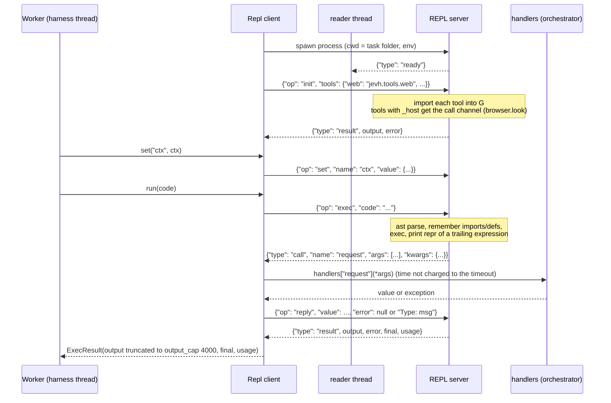

# 03 · Worker step loop and REPL

`Worker.run` (`worker.py:539`) is the heart of every task. Each **step** has three parts: build
the context, call the model, and act on the reply (run its code, or accept an answer). The
conversation is a plain `messages` list, and the harness rewrites it in a few places
(compaction, pauses, notes).

## One step

`*` The first-step nudge is skipped for `think: unlimited` models (`worker.py:563`).

### Notes the harness adds to a step's output

These are appended to the text the model gets back after running code (`worker.py:700`):

| Note | Trigger | Code |
|---|---|---|
| "Not run: there is no `x` tool…" | a native call to an unknown tool | `worker.py:632` |
| "Your <tool_call> text ran as Python: …" | XML-style calls written as text | `worker.py:642` |
| "The same error has now happened 3 times in a row…" | same last error line 3× | `_stuck_note`, `worker.py:1095` |
| "[2 steps left…]" / "[LAST STEP…]" | 2 or 1 steps left | `_steps_left_note`, `worker.py:1084` |
| Progress-check nudge / wrap-up order | see [05](05-stamina.md) | `worker.py:875` |

### How a result becomes a message

- **Native tools** (`native_tools: true`): the assistant message carries `tool_calls` (arguments
  re-encoded as valid JSON, `valid_args`, `worker.py:263`). The output goes back as a `tool`
  message with the first call's id. Extra calls get "(ran together with the first call)"
  (`_replies`, `worker.py:1075`).
- **Text mode**: one `user` message, `Output:\n…`.
- On the last step of a stalled worker, the model is offered only the `final` tool
  (`worker.py:1024`).

### Ways a task ends (`WorkerResult.stopped`)

| stopped | Meaning | Resumable |
|---|---|---|
| `final` | `final()` was called and passed the gate, or was accepted with problems listed | no |
| `plain` | a reply with no code, accepted as the answer | no |
| `max_steps` | step limit hit; files the worker wrote are copied to artifacts (`_harvest`, `worker.py:1106`) | yes |
| `stalled` | two progress strikes and the wrap-up step used | yes |
| `cancelled` / `error` | Stop pressed, or an exception (e.g. the model server died) | yes |

### Messages from the user while it runs

The loop is a `while step < self.limit` (a step spent hearing the user out raises the limit by one). At the top of
each step `_deliver_steers` appends the user's pending messages to the conversation (the end only, so the model
server's cache of everything before stays valid); a model reply cut by `steer()` comes back `redirected` and is kept
as context without anything in it running (`_redirect`); a `final()` while a message waits is held (`STEER_HELD`).
Code that is running is never cut. See [16 Interjection](16-interjection.md).

## The REPL process and its protocol

Each worker gets its own Python process: `python -u -m jevh.repl.server` with its working folder
as cwd, `JEVH_ARTIFACTS` pointing at the session's artifact store, and the env from `run_task`
(`repl/client.py:70`). The protocol is JSON lines. The server answers on a private duplicate of
the original stdout, and its fd 1 is pointed at stderr, so prints from child processes can't
corrupt the protocol (`repl/server.py:32-33`).

| Channel | Code | Details |
|---|---|---|
| Spawn and ready | `repl/client.py:70-90` | waits up to 30s for `ready`; tool import errors go to `stderr_tail` |
| Round trip | `repl/client.py:141` | restarts a dead REPL; on timeout (`limits.repl_timeout`, 1800s) kills the process tree and restarts: "[timed out…all variables were lost]" |
| Callbacks | `repl/client.py:160`, `:166` | any `{"type":"call"}` is dispatched to `handlers[name]`; exceptions come back as `RuntimeError` in the worker's code |
| Output cap | `repl/client.py:31` | 60% head + 40% tail, "… [N chars omitted; use peek() or slice] …" |
| Secret scrub | `repl/server.py:354` | an exec's output has unmistakable secret formats (`GOCSPX-…`, Slack/GitHub tokens, AWS key ids, Stripe live keys, private keys) replaced by `[secret hidden]` before it goes back to the model |
| Tool Jev usage | `repl/server.py:424-430` | `decide.TOTALS` delta per exec → `ExecResult.usage` → event `tool_usage` → usage.db `jev_tools` |
| Kill | `repl/client.py:39` | process group (POSIX) or `taskkill /T` (Windows): Chromium and jobs go with it |
| `input()` | `repl/server.py:63` | disabled: "ask the user by finishing with final()" (the worker has `ask_user` instead) |

### What the worker's code can call (`repl/server.py:251`)

| Helper | Runs where | Goes to |
|---|---|---|
| `peek`, `save_artifact` (a `data=` string that is only an existing file's name is treated as `path=`, `repl/server.py:181`), `load_artifact`, `list_artifacts`, `start_job`, `job_status`, `job_wait` | in the REPL | local files, subprocesses |
| `final(answer, artifacts, answer_var)` | in the REPL | sets `_FINAL`; non-string answers become JSON; bare artifact names resolve into the store; `changed` = files `project` touched |
| `llm_query(prompt, data)` | callback | the task's own model, one message (data clipped to 60k) |
| `jev(state, questions)` | callback | `Jev._ask("worker_jev")` |
| `request`, `request_async`, `wait`, `request_all` | callback | `Handles`, see [06](06-handoffs.md) |
| `ask_user(question, options, secret=False)` | callback | `Harness._ask_user`, see [10](10-observability.md); `secret=True`: typed hidden, `(hidden)` in events |
| `recall(query, k)`, `remember(fact)` | callback | Memory FTS + Jev gate; Learner fact store |
| `report_failure(what, detail)` | callback | `FailureWatch.report`: a `model` row in the failure log; the worker carries on ([11](11-failure-log.md)) |
| `mcp(tool, **args)` | callback | `McpHub.call` (only tools the persona's `mcp` globs allow) |
| `browser.look(q)` (through `_host`) | callback `look` | `see_image(llm, screenshot, q)`: the worker's own model looks at the image |
| `web`, `browser`, `project`, `nango`, `comfy` | in the REPL | see [08](08-tools.md) |

### Snapshot and restore

After every step, `_save` asks the REPL to `snapshot` its user variables
(`repl/server.py:292`). Imports and top-level `def` / `class` sources are kept as source text.
Values are pickled (dill if installed); anything over 16 MB or unpicklable is skipped. On resume,
`restore` replays imports, then defs, then values, and the worker is told which came back
(`RESTORED_NOTE`).
