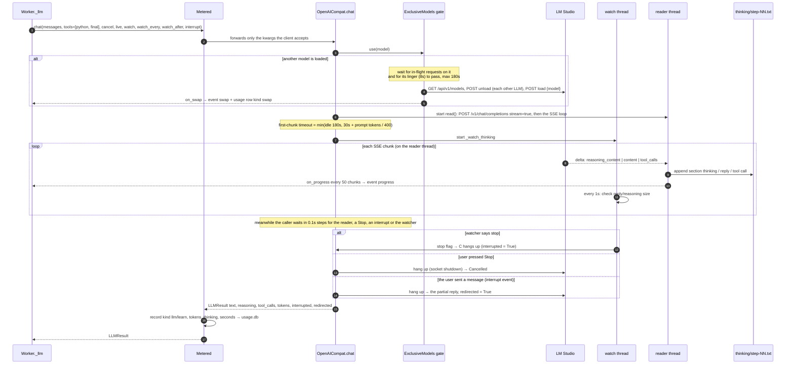
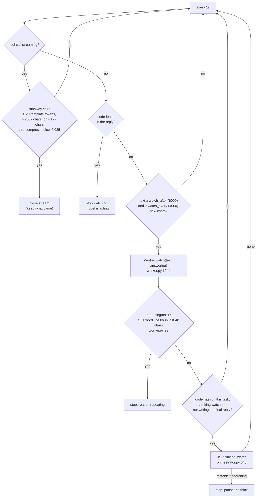
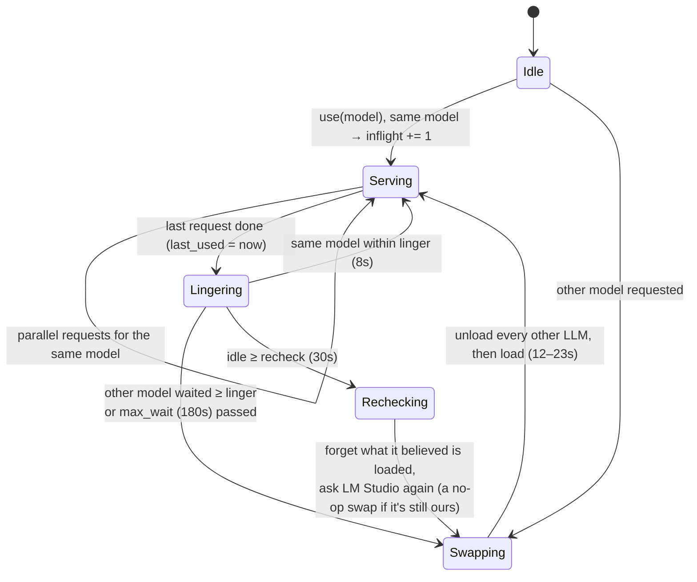

# 04 · Model calls

A worker step calls `Worker._llm` (`worker.py:1021`). That goes through `Metered`
(`usage.py:132`), then the provider client, which for LM Studio also passes the one-model gate
(`lmstudio.py:69`). The reply streams in on a reader thread while the calling thread waits for it and can stop waiting at
any moment (a Stop, a message from the user, the watcher), then hangs up: see [16 Interjection](16-interjection.md).

## The call chain



## Why the reply is read on its own thread

A model still reading its prompt sends nothing for a long time (LM Studio sends the response headers at once and the
first chunk when the prompt is read: ~22 s for 6k tokens, measured). A read that waits for the server cannot be woken
from another thread on Windows: neither `response.close()` nor `socket.shutdown()` ends it (and `close()` blocks on
the lock the reading thread holds). Cutting the stream from a helper thread therefore worked only once the server next
spoke: Stop during prompt reading waited for the first token, and a correction sent 9.7 s into a step landed at 28.5 s.
So `OpenAICompat._chat` reads on a thread of its own and the caller polls; to cut, it stops waiting, drops the
connection with `shutdown()` (the server sees it and cancels the task) and leaves the reader to end when the server
closes its side. A reader abandoned this way never touches the results again (`stopped`).

## The watcher thread (`_watch_thinking`, `llm.py:100`)

While the model hasn't started acting yet (no tool call, no ```` ``` ```` in the reply), the
watcher reads what it has written so far about once a second:



The watcher and the thinking watch together make the step return `interrupted=True`. The worker
then keeps the reasoning, trims the reply, and adds a pause message saying *why*: "you were
working out by hand something code does exactly…", "trying one theory after another…", or "you
were repeating yourself" (`worker.py:585-619`). After two ignored pauses in a row the next check
waits twice as long (`watch_after × 2`, `worker.py:1054`). The Jev thinking watch is off by
default (`limits.thinking_watch: 0`); the repetition check always runs.

## Failure handling

| Failure | Where | What happens |
|---|---|---|
| Nothing streams within the first-chunk limit | `llm.py:205` | `LLMError "no tokens for Ns (nothing streamed)"` |
| A gap between chunks > `idle_timeout` (180s) | `llm.py:205` | `LLMError "no tokens for 180s"` |
| Either of the above | `worker.py:1057` | the step is retried up to 2 more times (`SILENT_RETRIES`); sampling differs on a retry |
| HTTP error / unreachable | `llm.py:205` | `LLMError`: the task fails (`stopped=error`, resumable) |
| `finish_reason: length` | `llm.py:205` | "[output cut off at max_tokens…]" appended → the worker is told to use smaller steps |
| Template tokens leaked into call args | `llm.py:70` | cut at the first leaked token (`clean_call_args`) |
| `<think>…</think>` inline | `llm.py:205` | moved out of the text into `reasoning` |
| Primary provider down | `llm.py:357` | `WithFallback` uses the persona's `fallback:` model |
| Claude refuses | `llm.py:333` | "[the model declined this request]"; server-side fallbacks when configured |

## LM Studio: one model at a time (`lmstudio.py`)

Two big models loaded at once spill out of VRAM, and both slow to a crawl. One `ExclusiveModels`
gate per server URL (`gate_for`, `lmstudio.py:30`) is shared by every persona and tier.



`current` is only this process's belief. Another process on the same LM Studio (refine's test runs,
the dashboard next to a CLI) may have swapped models meanwhile, so after 30 idle seconds the gate
asks LM Studio again (`lmstudio.py:72`).

Swaps show up as the `swap` event (dashboard timeline markers) and as usage rows of kind `swap`
(`orchestrator.py:209`). Embedding models are never unloaded.

The same `GET /api/v1/models` says what context each loaded model has (`loaded_instances[].config.context_length`).
`ExclusiveModels.model_info(model)` reads it for the worker, which asks before every step to know where compaction
starts: a 3 s timeout, never under the swap lock, an answer reused for 10 s, and the last answer kept for 10 minutes if
LM Studio cannot be reached. [17 Context length](17-context-length.md).

## Metering (`Metered`, `usage.py:132`)

Every client from `Harness._llm` is wrapped. After each call it records one row:
`kind` (`llm`, or `learn` on the learning thread), `model` (the loaded one), `persona`, `task`,
`tier`, `input`, `output`, `thinking` tokens, `seconds` and `decode_seconds` (the tokens per second shown in a turn's footer,
[10](10-observability.md#usage-tracking-usagepy)). It takes these from the calling
thread's `_where()` tags. See [10](10-observability.md).
