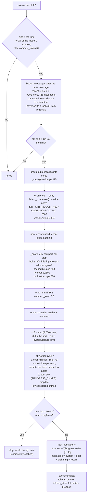
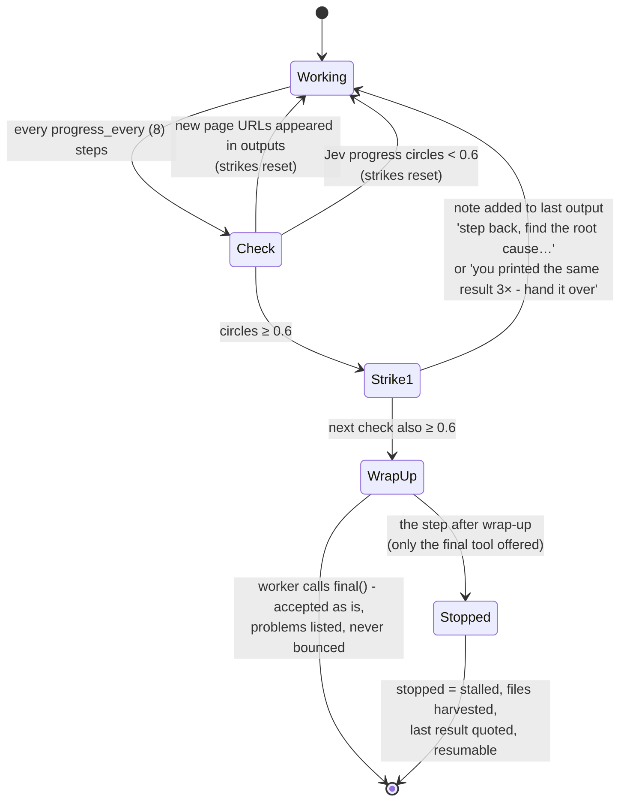
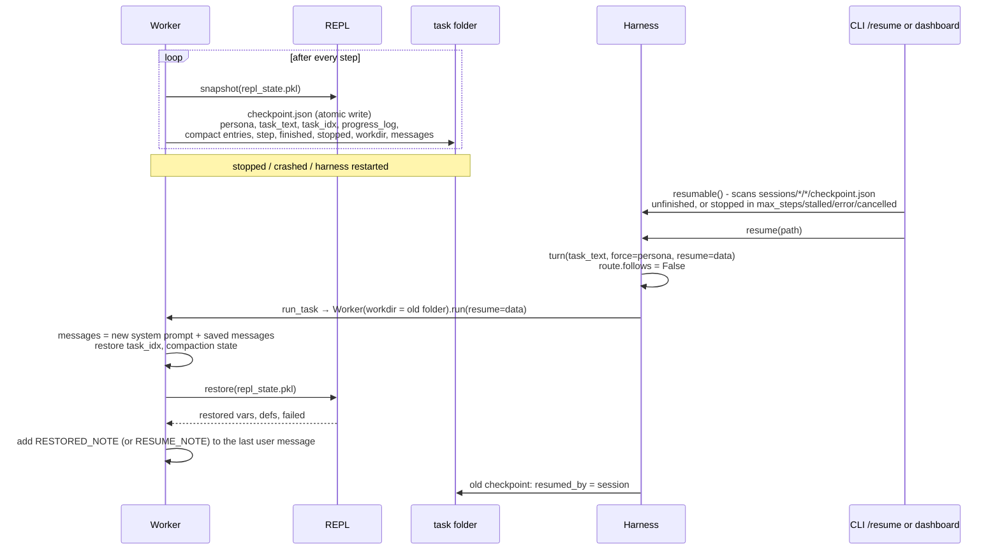

# 05 · Stamina: compaction, progress check, checkpoint and resume

These are the parts that let a worker run 20 to 60 steps without overflowing its context, going
in circles, or losing work when something stops it.

## Compaction (`Worker._compact`, `worker.py:754`)

Compaction runs at the start of every step, before the model call. It only fires when the
conversation is past the compaction limit (estimated tokens at 3.2 chars per token): `context.compact_at` (60%) of the
model's context window, as LM Studio loaded it ([17](17-context-length.md): 60,057 for Qwen's 100,096), or
`limits.compact_tokens` (60k) where the window is not known. The limit is read every step. It
makes **no model call**: Jev scores each old step, and plain code writes the log.

What survives compaction, and where:

| Kept | Where it lives afterwards |
|---|---|
| System prompt, follow-up turns | unchanged, before the task message |
| The task text | first part of the rewritten task message |
| Old steps Jev scored as needed | in full inside the progress log (capped sizes) |
| Other old steps | one-line notes: `- note:`, `- ran: <first 8 lines>`, `-> <output 400 chars>` |
| The last 3 steps | verbatim messages |
| Variables, files, the project | untouched (the REPL isn't touched) |

The compaction state (`_entries`, `_dropped`) is saved in `checkpoint.json` so a resumed task
keeps its log. The dashboard's **context ring** comes from the `context` event
(`_report_context`, `worker.py:726`). It is sent every step and splits the estimated prompt into
instructions, tools, skills, task, work and output, out of the compaction limit; it also says what the model's
window is when the harness knows it (`window`, `source`, `loaded`, `max`, `parallel`, `warn`).

## Progress check (`Worker._stalled`, `worker.py:875`)

- The Jev question gets the task text (1.5k) and the condensed last 16 messages (4k).
- `new_pages` (`worker.py:64`) counts only URLs that appeared in tool **outputs**, not URLs the
  worker typed. A page it hadn't reached before counts as progress, however similar the steps look.
- Each check emits `progress_check` `{circles, stuck, strike, new_pages}`.

## Other stamina guards

| Guard | Code | Effect |
|---|---|---|
| Same error 3× | `worker.py:1095` | "Stop retrying it. Try a genuinely different approach, or call final()" |
| 2 steps / 1 step left | `worker.py:1084` | "save your deliverables… call final()" / "LAST STEP" |
| Repetition in a reply | `worker.py:93` | the stream is stopped and the worker told to do what it keeps saying it will do |
| Thinking watch | `orchestrator.py:646` | see [04](04-llm-streaming.md#the-watcher-thread-_watch_thinking-llmpy100) |
| Step limit | `worker.py:714` | files harvested, the last output quoted, resumable |
| Hidden reasoning kept | `worker.py:518` | the last 40k chars of each step's reasoning go back as `reasoning_content` (`limits.keep_reasoning`) |

## Checkpoint and resume

Code: `_save` `worker.py:944`, `resumable` `orchestrator.py:291`, `resume` `orchestrator.py:311`,
`_add_resume_note` `worker.py:930`, `snapshot` / `restore` `repl/server.py:292`, `:316`.

### A turn that was cut off, and "continue"

A turn the harness never finished (a crash, or the dashboard restarted under it) used to leave only its task folder: it
was never remembered, so the next turn knew nothing of it. Live (2026-10-12, flagged session 10): "get REA running on
this computer" died at step 42 with a restart, and the user's "continue" was answered by explaining the repo again.

Before every new turn, `Harness._note_cut_off` looks at the session's last turn (`_last_cut_off`: its lead task's
checkpoint, unfinished or stopped in `RESUMABLE`, not taken up since). One that never finished is remembered then, once
(`noted` in its checkpoint), as `CUT_OFF_NOTE` ("this turn was cut off at step N ...") with the work it had done as the
turn's notes, so routing, the follow-up check and the conversation the next worker sees all have it. If the new message
only asks to carry on (`CONTINUE_RE`: "continue", "ok keep going", "resume please", "pick up where you left off"; not
"continue with the calculator instead"), `turn()` resumes that task instead (`resume(path)`: its conversation, folder
and REPL variables), with a `resuming` event. Bench: `evals/bench/flagged.py --stage resume`.
