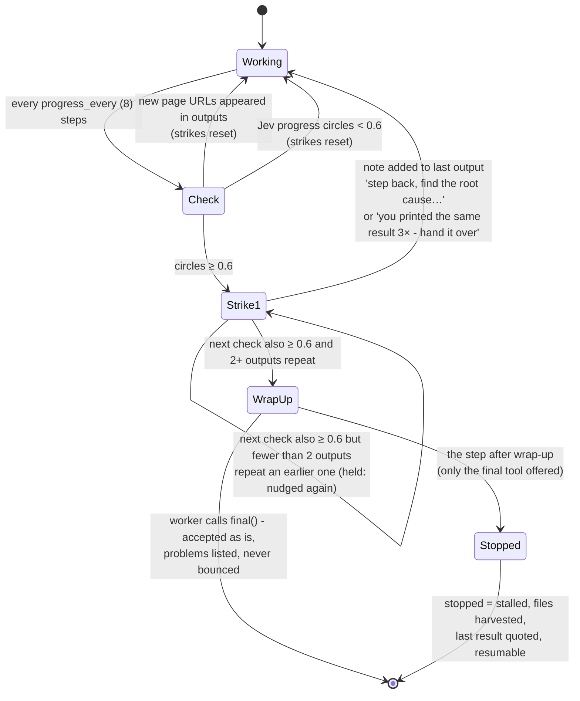
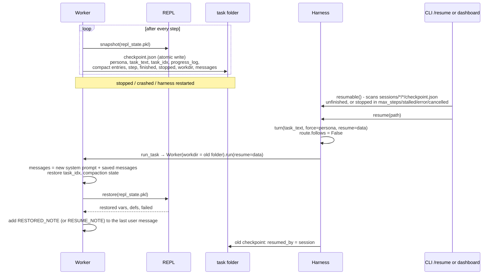

# 05 · Stamina: compaction, progress check, checkpoint and resume

These are the parts that let a worker run 20 to 60 steps without overflowing its context, going
in circles, or losing work when something stops it.

## Compaction (`Worker._compact`, `worker.py:754`)

Compaction runs at the start of every step, before the model call. It only fires when the
conversation is past the compaction limit: `context.compact_at` (80% since 2026-10-18, was 60%) of the model's context
window as the server reports it ([17](17-context-length.md)), but never so late that the reply's room is gone (a quarter
of the window for a model that thinks without limit, so 80% is really 75%: 57,024 of the 76,032 Qwen has on
llama-server), or `limits.compact_tokens` (60k) where the window is not known. The prompt's size is the server's own
token count of the last prompt plus what changed since (`context.measure`), or, without it, 3.2 chars a token. The
limit is read every step. It makes **no model call**: Jev scores each old step, and plain code writes the log.
Why these values: [Compaction defaults (2026-10)](#compaction-defaults-2026-10) below.

```mermaid
flowchart TD
  A["size = the server's count of the last prompt<br/>+ what changed since (measure; else chars / 3.2)"] --> B{"size > the limit<br/>(80% of the model's window, the reply's<br/>room kept; else compact_tokens)?"}
  B -- no --> X["no-op"]
  B -- yes --> C["body = messages after the task message<br/>recent = last 2 × keep_steps (6) messages,<br/>cut moved forward to an assistant turn<br/>(never splits a tool call from its result)"]
  C --> D{"old part ≥ 10% of<br/>the limit?"}
  D -- no --> X
  D -- yes --> E["group old messages into steps<br/>_steps() worker.py:115"]
  E --> F["each step → entry<br/>brief: _condense() one-line notes<br/>full: _full() THOUGHT 400 / CODE 1500 / OUTPUT 2000<br/>worker.py:843, 854"]
  F --> G["now = condensed recent steps (last 2k)"]
  G --> H["_score: Jev compact per step<br/>'holds info finishing the task will use again?'<br/>cached by step text<br/>worker.py:801 → orchestrator.py:636"]
  H --> I["keep in full if P ≥ compact_keep 0.8"]
  I --> J["entries = earlier entries + new ones"]
  J --> K["soft = max(8,000 chars,<br/>0.6 × the limit in chars − system/task/recent)"]
  K --> L["_fit<br/>1. over min(soft, cap): re-score full steps fresh,<br/>demote the least needed to notes<br/>2. over the cap: drop the lowest-scored entries<br/>(cap = log_share 25% of the limit, at least<br/>PROGRESS_CHARS 16k chars)"]
  L --> M{"new log ≥ 90% of<br/>what it replaces?"}
  M -- yes --> X2["skip: would barely save<br/>(scores stay cached)"]
  M -- no --> N["task message :=<br/>task text + '[Progress so far …]' + log<br/>messages = system + prior + task msg + recent<br/>(archive: the condensed steps appended in full<br/>to the task folder's history.md, [#n] in the log)"]
  N --> O["event compact<br/>tokens_before, tokens_after, full, notes, dropped"]
```



What survives compaction, and where:

| Kept | Where it lives afterwards |
|---|---|
| System prompt, follow-up turns | unchanged, before the task message |
| The task text | first part of the rewritten task message |
| Old steps Jev scored as needed | in full inside the progress log (capped sizes) |
| Other old steps | one-line notes: `- note:`, `- ran: <first 8 lines>`, `-> <output>`: its first 260 and last 140 chars (`note_tail`; else the first 400) |
| Every condensed step, in full | `history.md` in the task folder (`archive`); the log's `[#n]` tags point into it |
| The last 3 steps | verbatim messages |
| Variables, files, the project | untouched (the REPL isn't touched) |

The compaction state (`_entries`, `_dropped`) is saved in `checkpoint.json` so a resumed task
keeps its log. The dashboard's **context ring** comes from the `context` event
(`_report_context`, `worker.py:726`). It is sent every step and splits the estimated prompt into
instructions, tools, skills, task, work and output, out of the compaction limit; it also says what the model's
window is when the harness knows it (`window`, `source`, `loaded`, `max`, `parallel`, `warn`).

## Compaction defaults (2026-10)

Jed's notes: "change compaction to trigger at 80% instead of 60%, should give us better outputs", and on a flagged session
"compaction throughout the session seemed to cause massive degradation". Measured with `evals/bench/long_horizon.py`
(full harness turns, Qwen3.8 27B on llama-server, the semif Jev; 51 runs between 2026-10-08 and 10-13; raw rows in
`evals/bench/long_horizon_raw.json`, the tables in `long_horizon_summary.txt`). The task: 18 memo pages of rules mixed
with stale numbers, a `policy.py` to write, 80 hidden tests. To make it compact several times, the harness was told the
window is 24k (`--window 24000`; the server really has 76k, so an overshoot fails nothing). Variants: `base` (60%,
the old default), `at80` (80% alone), `at80_measure`, `at80_all` (80% + measure + archive + note_tail + log_share 0.25).

| window told, seeds | variant | runs | solved | re-reads after compaction | compactions | peak real prompt / window | minutes | prefill s | condensing s |
|---|---|---|---|---|---|---|---|---|---|
| 24k, dev 1-3 | base | 9 | 7/9 | 3.8 | 3.0 | 83% | 7.8 | 55 | 11 |
| 24k, dev 1-3 | at80 | 9 | 9/9 | 1.7 | 1.4 | **110%** | 10.4 | 38 | 8 |
| 24k, dev 1-3 | at80_measure | 6 | 5/6 | 1.7 | 2.5 | 75% | 6.9 | 46 | 8 |
| 24k, dev 1-3 | at80_all | 9 | 9/9 | 1.2 | 3.9 | 80% | 10.2 | 73 | 12 |
| 24k, held-out 11-13 | base | 6 | 6/6 | 6.0 | 3.5 | 93% | 11.4 | 126 | 13 |
| 24k, held-out 11-13 | at80_all | 6 | 6/6 | 2.3 | 3.3 | 79% | 12.1 | 147 | 15 |
| real 76k, dev 1-3 | base | 3 | 3/3 | 0 | 0 | 49% | 7.2 | 23 | 0 |
| real 76k, dev 1-3 | at80_all | 3 | 2/3 | 0 | 0 | 45% | 6.5 | 26 | 0 |

Means per run; "peak" is each run's largest prompt as the server counted it, over the window the harness was told.
At the real window the task never compacted: the largest prompts were 47,978 tokens (base; over its own 45,619 limit,
not condensed because the estimate said it was under) and 46,540 (at80_all). The held-out runs shared Qwen's two slots
with other work, so their minutes are slower for both variants. Code: the first 13 rows ran before `dcef277`, the rest on
it (the fence fix and `say()`), interleaved across variants.

What it says:

- **Every failure was the progress check, not lost information.** All 4 unsolved runs of 51 were stopped by two
  "same attempt repeating" strikes before `policy.py` was written. Two (base, dev) came after compaction made the worker
  read pages again; the other two (at80_measure, and at80_all at the real window) had not compacted at all: reading
  page after page looked like repetition to Jev. 20 of the 51 runs got at least one strike. On long reading tasks that
  check is a bigger risk than compaction (a follow-up; not changed here).
- **80% re-reads less.** Pages opened again after a compaction: base 3.8 (dev) and 6.0 (held-out), the 80% variants
  1.2-1.7 (dev) and 2.3 (held-out).
- **80% is only safe with `measure`.** The 3.2 chars-a-token estimate does not count the code inside native tool calls
  and is wrong for numbers and JSON (measured on Qwen: prose 4.5 chars a token, code 4.0, JSON 3.1, digit grids 1.0).
  Plain 80% sent prompts of up to 110% of the window the harness was told: on a real window, an overflow. With
  `measure` the peak was 75-80%. Real sessions at the old 60% (`workspace/usage.db`, the 70 Qwen tasks since
  2026-10-07): 9 sent prompts past 60% of 76k, 4 past 75%, the largest 69,026 tokens (91%). Even 60% was not 60%.
- **What it costs.** Counted by the server the prompt is bigger, so at80_all compacted about as often as base (3.9 vs
  3.0 dev, 3.3 vs 3.5 held-out). Each compaction rewrites the prompt's start, so the server reads all of it again:
  prefill 73 s vs 55 s a run (dev), 147 vs 126 (held-out); condensing itself (Jev scoring the old steps) 12-15 s a
  run. The minutes per run did not differ beyond the run-to-run noise.

Shipped (config.yaml `context:`, and `context.DEFAULTS`): `compact_at: 0.8`, `measure: true`, `archive: true`,
`note_tail: true`, `log_share: 0.25`: the `at80_all` set, the one with the most runs behind it (17 of 18 solved across
dev, held-out and the real window; the one failure stopped by the progress check before any compaction). `measure` is
the part the numbers require. The other three ship because they were in the tested set and nothing measured against
them, **not** because the bench showed that each one helps:

- `archive`: the worker read `history.md` in 1 of the 15 at80_all runs that compacted. Cheap (a file written per
  compaction, one sentence and `[#n]` tags in the log), rarely used.
- `log_share`: inert at a 24k window (the cap is the larger of 16,000 chars and 25% of the limit, about the same
  there). It matters on the real window: 25% of 57,024 tokens is ~14k tokens of log, against 16,000 chars (~4-5k
  tokens) before. The flagged sessions below show what the fixed cap did. **Not verified live at the real window with
  compaction**: the bench's task fits in 76k.
- `note_tail`: not tested on its own.

Two flagged sessions (read from their checkpoints, thinking files and `workspace/usage.db`):

- `20261012-095826-956c` (chess in Bilbo's browser), turn 3: 65 steps; the server counted prompts of up to 58,004
  tokens (76% of the window) under a limit of 45,619 by the estimate. Its compaction state at the end: 27 old steps as
  one-line notes, **none in full** (Jev scored them 0.80-0.95), and 34 left out, which is the 16,000-char log cap at
  work. The board lived in a REPL variable and survived. "The helper module was lost" was not compaction: it is the
  turn's second step, and each turn has its own folder, so the `chessplay.py` written in turn 2 was not in turn 3's.
  Most of that session's damage was the plain ``` block run as Python (fixed in `dcef277`: `worker.code_blocks`). With
  the new defaults the turn would have condensed at about the same real size (57,024 counted, against an estimate that
  undercounted by about as much) with a log of up to ~14k tokens instead of 16,000 chars; what it would then have
  kept is not measured.
- `20261012-132818-4af5` (Facebook setup, "taking way too long"): turn 1 (82 steps, 29.9 min) ended with 40 condensed
  steps left out and 28 kept as notes, none in full; turn 4 (61 steps, 38.4 min) with 31 left out and 17 notes. The
  time was not compaction. Turn 4: Qwen took 1,734 s over its 62 calls, 1,592 s of it generating (76,112 thinking
  tokens), so at most ~141 s reading prompts (every prompt, not only those after a compaction); all 86 Jev calls of the
  turn (compaction scores, progress checks, the answer gate) took 29 s. Turn 1: 647 s of model calls (494 s
  generating, ~153 s reading), Jev 22 s; 19 of its 30 minutes were between model calls (the tools: a browser on another
  computer). Compaction cost at most ~3 minutes of either turn; thinking took most of turn 4.

What would show the defaults are wrong: a real session on them that fails on the window (the server refusing an
over-long prompt), or `python evals/bench/long_horizon.py --variants base,at80_all` on a task that compacts at the real
window solving fewer runs with at80_all. Untuned: `log_share` 0.25 and the 260/140 split of a note are guesses;
`COMPACT_TARGET` 0.6 and `compact_keep` 0.8 are unchanged.

## Progress check (`Worker._stalled`, `worker.py:875`)



- The Jev question gets the task text (1.5k) and the condensed last 16 messages (4k).
- `new_pages` (`worker.py:64`) counts only URLs that appeared in tool **outputs**, not URLs the
  worker typed. A page it hadn't reached before counts as progress, however similar the steps look.
- Each check emits `progress_check` `{circles, stuck, strike, new_pages}` (`held: true` when a second strike was held).
- **A second strike stops the task only if 2+ of its step outputs nearly repeat an earlier one** (`repeated_outputs`,
  `STOP_REPEATS`). The long-horizon bench (2026-10) found every run the check stopped reading the task's rule pages,
  one a step: alike to Jev, each output new (0 repeats in all 4 whose checkpoints were kept); the two real loops in the
  failure log (clicks on another computer that kept timing out) had 3 and 2 of 8. Replayed on those saved runs, not
  re-run live (the false stops were 4-5 in 51 runs: too rare to show in a few runs). `STOP_REPEATS = 2` rests on those two
  loops: wrong if a real loop with varied outputs (different errors each step) now runs to the step limit.

## Other stamina guards

| Guard | Code | Effect |
|---|---|---|
| Same error 3× | `worker.py:1095` | "Stop retrying it. Try a genuinely different approach, or call final()" |
| 2 steps / 1 step left | `worker.py:1084` | "save your deliverables… call final()" / "LAST STEP" |
| Repetition in a reply | `worker.py:93` | the stream is stopped and the worker told to do what it keeps saying it will do |
| Thinking watch | `orchestrator.py:646` | see [04](04-llm-streaming.md#the-watcher-thread-_watch_thinking-llmpy100) |
| Step limit | `worker.py:714` | files harvested, the last output quoted, resumable |
| Hidden reasoning kept | `worker.py:518` | the last 40k chars of each step's reasoning go back as `reasoning_content` (`limits.keep_reasoning`) |

## Checkpoint and resume



Code: `_save` `worker.py:944`, `resumable` `orchestrator.py:291`, `resume` `orchestrator.py:311`,
`_add_resume_note` `worker.py:930`, `snapshot` / `restore` `repl/server.py:292`, `:316`.

### A turn that was cut off, and "continue"

A turn the harness never finished (a crash, or the dashboard restarted under it) used to leave only its task folder: it
was never remembered, so the next turn knew nothing of it. Live (2026-10-12, flagged session 10): "get REA running on
this computer" died at step 42 with a restart, and the user's "continue" was answered by explaining the repo again.

Before every new turn, `Harness._note_cut_off` looks at the session's last turn (`_last_cut_off`: its lead task's
checkpoint, unfinished or stopped in `RESUMABLE`, not taken up since). One that never finished is remembered then, once
(`noted` in its checkpoint), as `CUT_OFF_NOTE` ("this turn was cut off at step N ...") with the work it had done as the
turn's notes, so routing, the follow-up check and the conversation the next worker sees all have it. If the new message
only asks to carry on (`CONTINUE_RE`: "continue", "ok keep going", "resume please", "pick up where you left off"; not
"continue with the calculator instead"), `turn()` resumes that task instead (`resume(path)`: its conversation, folder
and REPL variables), with a `resuming` event. Bench: `evals/bench/flagged.py --stage resume`.

### A follow-up turn starts where the last one left off

Each turn's lead task gets its own folder and a fresh REPL. A follow-up by the same assistant (Jev's follow-up check said
the message continues the conversation) now starts with the previous turn's REPL state restored (`Worker.carry_from`,
`_carry`: the `repl_state.pkl` the worker snapshots after each step and, now, when it finishes) and the task message
names that turn's folder (`CARRIED_NOTE`, in the task text so compaction keeps it). Live (2026-10-12, a chess game
played over several turns, flagged session 8): every move began "the helper module was lost - let me rebuild it". A
new topic still starts fresh. Bench: `evals/bench/flagged.py --stage carry`.

### Earlier requests in a continued conversation

With `limits.session_context` (see [01-turn.md](01-turn.md)) the same assistant's conversation goes on across requests, so
the prompt holds earlier requests and all their steps. They are left whole until the prompt passes the compaction limit;
then `_compact` condenses them before touching this request's steps (`Worker._compact_earlier`): each earlier request
becomes a record at the head of this task message (`EARLIER_HEAD`) - the request, its steps (Jev keeps the ones the work
still needs in full, as for this request's own steps; the rest become one-line notes; a request that was compacted while
it ran keeps its progress log), and the answer it gave. The next request continues from that, and condenses the requests
after it onto the same record. The checkpoint keeps the record (`earlier`) and where each request starts (`turns`), so a
resumed or continued conversation has them. A turn cut off mid-step can end on a tool call nothing answered: `_carried`
leaves such a call out, since a server refuses a call without its result.
Live check, 2026-10-24 (`evals/bench/session_context.py -k data,sonos --arm new --compact-at 0.05`, i.e. compaction at
the 16k floor instead of ~209k): 8 of 9 follow-ups ran with earlier requests condensed, and all 9 passed - the speakers'
volumes, the stalled stream found and fixed, "what was the total again?" five requests later. (The Sonos replay's first
request, squeezed into 16k on its own, ran out the bench's 12 minutes: within-turn compaction at a size no real window has.)
