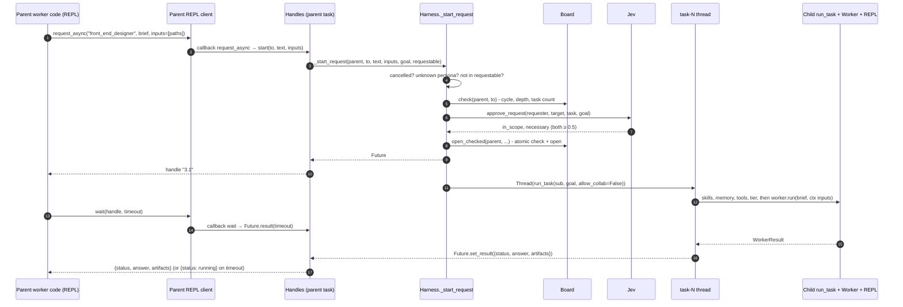

# 06 · Hand-offs between personas

A worker delegates by calling `request`, `request_async` / `wait`, or `request_all` in its REPL.
Each approved hand-off becomes a **new task** on the turn's board. It runs `run_task` on its own
thread, with its own REPL process and a fresh context: the helper sees only the brief and the
input paths.

## What a child gets and doesn't get

| Child gets | Child doesn't get |
|---|---|
| `task.text` = the brief (the parent must write it completely) | the user's conversation or follow-up history |
| `ctx['inputs']` = the artifact paths the parent passed | the parent's REPL variables |
| its own memory gate (on the brief), skills, tool guides, tier | a collaborator suggestion (`allow_collab=False`) |
| the same `goal` (the user's message) for Jev's `approve` question | — |
| its own working folder `u<turn>t<id>-<persona>` and REPL | — |
| the shared session artifact store | — |

## Limits that hold no matter what Jev says (`bus.py`)

| Check | Code | Default |
|---|---|---|
| Cycle: target already in the chain | `Board.check`, `bus.py:59` | — |
| Depth | `bus.py:62` | `limits.max_depth` 3 |
| Tasks per turn, including rejected ones | `bus.py:64` | `limits.max_tasks_per_turn` 8 |
| Parallel race for the last slot | `open_checked`, `bus.py:74` | check and open under one lock |
| Turn stopped | `orchestrator.py:535` | new hand-offs refused |

A refused hand-off is still recorded on the board (`Board.reject`, status `rejected`) and emitted
as a `request` event with `approved: False`. Its Future resolves at once to
`{"status": "rejected", "answer": reason}`, so the parent's code gets the reason as data.

## Parallelism

- Each child runs on a thread named `task-<id>-<persona>` (`orchestrator.py:565`).
- `wait([h1, h2], timeout)` shares one deadline across the list (`orchestrator.py:111`).
- A hand-off the parent never waited for is still finished and its artifacts are merged into the
  parent's result (`collect_unwaited`, `orchestrator.py:514`) → event `unwaited`.
- Children on different models share LM Studio through the gate's linger, which costs about one
  swap per worker instead of one per step ([04](04-llm-streaming.md#lm-studio-one-model-at-a-time-lmstudiopy)).
- The CLI prints `hand-offs: Xs of work in Ys wall (parallel saved Zs)` from the tasks' start and
  finish times (`handoff_overlap`, `cli.py:34`).
