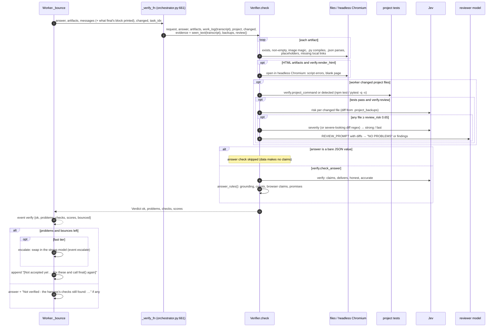
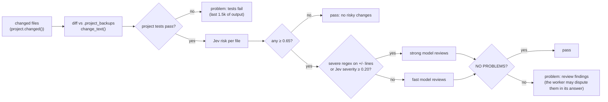

# 07 · The final() gate

When a worker calls `final()`, or replies with plain text and no code, `Worker._bounce`
(`worker.py:966`) runs the verifier before accepting. Problems go back to the worker as a new
message ("Not accepted yet: …"), with its REPL state intact. After `verify.max_bounces` (2), or
on a stalled worker's wrap-up step, the answer is accepted with the unresolved problems listed
under it. It is never accepted silently.

## Answer rules (`answer_rules`, `verify.py:194`)

| Problem raised | Condition |
|---|---|
| Unsupported numbers | the answer has 2+ digit numbers (not years) that appear nowhere in the request, prior turns, or tool outputs (`grounding`, `verify.py:167`); only once tools ran. Not counted against it (live false bounces, 2026-10-12): a rate a source prints without its zero (`$.49` is 0.49); a total the answer works out in the open from numbers the tools gave (`$2,800 ($2,000 + $800)`, `_derived`, sums and products, one level of totals of totals); a duration estimate (`a 30-second fix`); an approximation (`~20`, `about 20`) within 15% of a figure the tools gave. The replay in `evals/bench/flagged.py --stage replay` re-checks every draft your gate sent back over numbers |
| Claims not in the log (first of these three that applies) | `claims ≥ verify_claims 0.80` |
| … else doesn't deliver | `delivers < 0.80` and not `honest ≥ 0.80` |
| … else inaccurate report | code was run (the log isn't empty), `accurate < verify_accurate 0.40`, not honest, and the numbers aren't grounded (2+ supported, none unsupported) (`verify.py:206`) |
| Too few deliverables | the request says "three logos" (2 to 20) and fewer files came, unless honest |
| Named file not handed over | the request names a file to make after a making verb ("write leap.py"; `DELIVERABLE`) and no handed-over file has that name, unless honest. A file the harness collected itself is stored as `<persona>_<name>` and counts. After a message the user sent mid-task that names a file, only that message's names are due (`files_from`, [16](16-interjection.md)): a redirect from `fib.py` to `primes.py` no longer asks for `fib.py` |
| Browser claim without browser use | "checked … in the browser" and no `browser.` in the log, unless the log shows `nango.open_page` / `connect_and_wait` / `start` (a page opened in the user's own browser, `OPENED_FOR_USER`) |
| Promise instead of work | "next I'll …" and not a question to the user, nor waiting for the user's word ("Reply go and I'll create it", "once you've saved it, say saved and I'll finish": `USER_FIRST` before the promise in its line) |
| Secret asked for in the chat (nango in use) | the answer asks the user to paste or send a password, key or client secret (`asks_for_secret`) and doesn't say it is asked hidden: `nango.setup()` asks, typed hidden |
| Nango step claimed or promised, not done | `nango` is the topic (in the evidence, request or answer) and no `nango.…(` call is in this reply's log, and the answer says an account "is connected" / "all set up" (`NANGO_CLAIM`) or "I'll hand it to Nango" (`NANGO_PROMISE`) |

The harness also hides the answer to any free-text `ask_user` whose question asks for a password or
key (`asks_for_secret`, used by `Harness._ask_user`), whatever the worker passed: the same check as
the first of the two nango rules, applied to a question instead of an answer.

`work_log` (`learn.py:151`) is the compact log Jev reads: code heads and 350-char outputs, plus
the output lines that mention the answer's numbers and words. `seen_text` (`learn.py:137`) is the
uncut evidence for grounding: everything the worker was shown, but not its own replies.

## File checks (`Verifier._file`, `verify.py:296`)

| Type | Checks |
|---|---|
| any | exists; not empty; its whole content isn't just a file name (`save_artifact("planets.csv", "planets.csv")` once handed over an 11-byte file; `_names_a_file`, `verify.py:122`) |
| `.png .jpg .jpeg .gif .webp` | magic bytes match |
| `.py` | compiles |
| `.json` | parses |
| `.html .htm .svg .md .txt .css .js .csv` | no placeholder text (lorem ipsum, TODO, `[Your Company]`, `{{ x }}`, example.com…); HTML visible text only |
| `.html .htm` | no `src`/`href` to local files that don't exist; renders without script errors or a blank body (`_render`, `verify.py:307`) |

## Risky project changes

A diff is reviewed at most once (`Verifier._reviewed`), so a worker that disputes the findings
without changing anything isn't bounced twice for the same diff.
