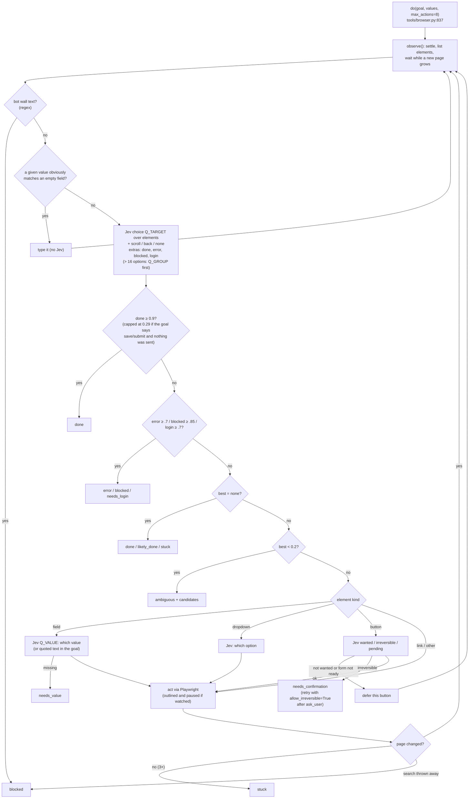
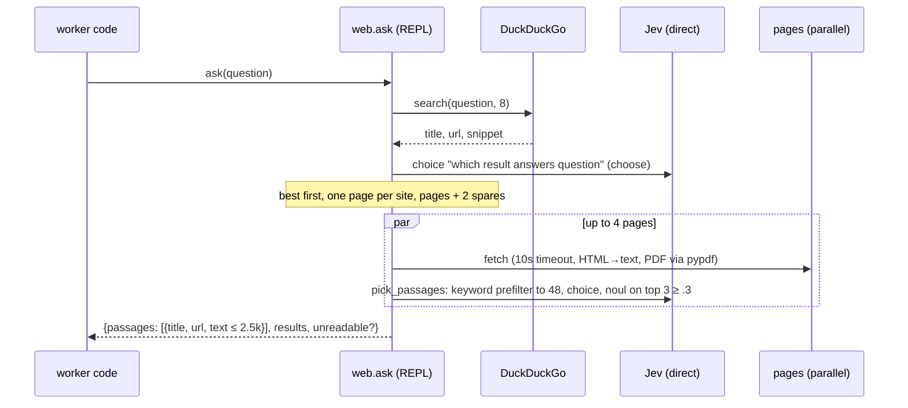
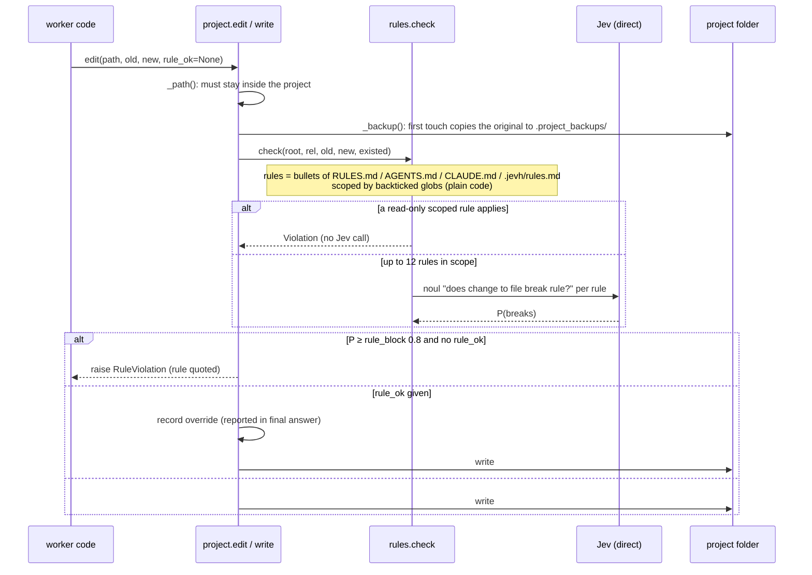
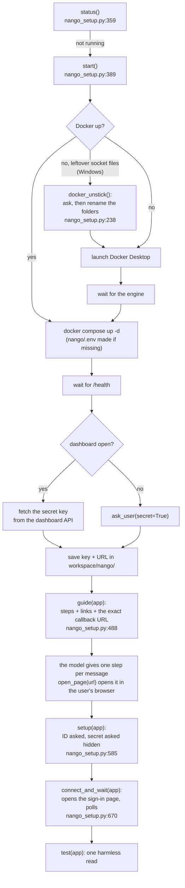

# 08 · Tools and their own Jev loops

Tools are Python modules imported into a worker's REPL under their name (`init` op,
`repl/server.py:394`). Jev picks per task which tools' **guides** go into the prompt (step
`tools`). All of the persona's tools are importable either way. The tools run inside the REPL
process. Several of them run their own Jev loops, talking straight to the adapter
([02](02-jev-decisions.md#tool-side-decisions-inside-the-repl-recorded-as-kind-jev_tools)).

| Tool | Module | Talks to | Jev loop | Harness callbacks |
|---|---|---|---|---|
| `browser` | `tools/browser.py` | Chromium via Playwright (own thread) | `do()`: pick element / value / option, button checks, done-checks | `look` → the worker's model sees a screenshot |
| `web` | `tools/web.py` | DuckDuckGo HTML, any page | result ranking, passage picking | — |
| `project` | `tools/project.py` + `tools/rules.py` | the user's project folder, shell | `find` / `find_files` ranking; rule enforcer on every edit | — |
| `nango` | `tools/nango.py` + `tools/nango_setup.py` | Nango API proxy → the user's apps; Docker, the Nango on this machine, the providers' consoles | — | `ask_user` for every change, and for setup (the secret one is hidden) |
| `comfy` | `tools/comfy.py` | ComfyUI `:8188` | — | — |
| MCP | `mcp.py` (in the harness) | stdio JSON-RPC servers | `mcp_rank` / `mcp_fits` at task setup | `mcp(key, **args)` callback |

## browser.do(goal): the Jev-driven browser loop

The worker states **one outcome**, and Jev picks every click. The worker's model never reads a
page snapshot. Each call runs on the browser's own thread (`_run`, `tools/browser.py:1283`).

Every result is `{status, goal, url, title, actions, note, page (1.2k), p, jev_calls,
jev_seconds, seconds}`. When Jev couldn't finish, it adds `candidates` (numbered elements), so the
worker can act itself with `browser.click(i)` / `fill(i, text)` / `select(i, option)`.

`browser.test(url, steps, expect)` runs `do()` per step with `act_first`, then checks `expect`
with two nouls (`shows ≥ .55` and `holds ≥ .6`) and reports JS and console errors. With the
dashboard's "Watch browser" on, the browser runs with a CDP port (`JEVH_BROWSER_DOCK`), and the
dashboard mirrors it and passes the user's clicks back ([10](10-observability.md)).

## web.ask(question)

## project: edits go through the rule enforcer

`project.changed()` lists the touched files. `final()` sends that list to the gate, which runs
the project's tests and reviews risky diffs against the backups ([07](07-final-gate.md)).

## nango: changes are approved by the user, from inside the tool

`nango.request` (`tools/nango.py:311`) sends every call through Nango's `/proxy` with the
connection's key, so no token reaches a prompt. A method that isn't a read (`is_read`), or any
call with `base_url=`, goes through `_approve` (`tools/nango.py:286`). `_approve` asks through `_ask`
(`tools/nango.py:101`), which calls the REPL's own `_call("ask_user", …)` directly, so the worker's
code can't answer for the user. The options are `Allow`, `Allow all <app> changes this task`, and
`Don't allow`. `tools.nango_writes: deny` refuses all changes, and `allow` skips the question.

### nango setup: the walk-through and what code does for it

A first connection (Nango running, an app registered at the provider, its ID and secret, a sign-in) is
a long task for a small model, so code does every step that doesn't need a person and the model only
orders the steps and talks. `tools/nango_setup.py` is reached as `nango.start()`, `nango.guide()`, …
(a module `__getattr__`, `tools/nango.py:364`). The `nango-setup` skill is the playbook; the tool is
offered before Nango is set up (its description says so: `summary()`, `tools/nango.py:250`), so "connect
my Gmail" reaches it.

- **State without a restart.** `start()` saves the secret key and URL to `<workspace>/nango/`
  (`JEVH_NANGO_DIR`, set by `Harness.__init__`); `_key()` / `_base()` (`tools/nango.py:88`, `:97`)
  use them when the environment says nothing, so the harness can use Nango in the same session that
  set it up. The environment wins, and `start()` warns when a different key there would shadow it.
- **Secrets never ride in a transcript.** `ask_user(..., secret=True)` (`repl/server.py:148`) makes
  a `PendingQuestion` with `secret=True` (`orchestrator.py:148`): no option buttons, a hidden input in
  the dashboard (`#input.secret`) and CLI (`getpass`), and the `answered` event carries `"(hidden)"`.
  `setup()` asks for the secret itself and passes it straight to Nango, so the answer never reaches
  the worker's code; `page=browser.read()` finds the ID and secret by regex (`_find_credentials`,
  `nango_setup.py:557`) without returning them, and an error from Nango is scrubbed of both before
  it is raised. A page the worker reads can show a secret too (Google's "OAuth client created"
  dialog came back in `browser.do()`'s result and was echoed into the work log, live 2026-10-02), so
  the REPL cuts unmistakable secret formats out of every cell's output (`scrub_secrets`,
  `repl/server.py:354`): Google client secrets, Slack and GitHub tokens, AWS key ids, Stripe live
  keys, private-key blocks. The code that holds the value still has it. Not covered: a secret in a
  global variable is saved with the REPL checkpoint (`repl_state.pkl`) in the session folder, on
  this machine.
- **`open_page(url)`** only opens this machine's Nango and URLs `guide()` or the tool itself gave
  out (`_offered`); anything else is refused, so injected text can't open a page in the user's browser.
- **Docker on Windows** can fail to start on dead socket files an unclean exit left
  (`remove …engine.sock: The file cannot be accessed by the system`). `_ensure_docker`
  (`nango_setup.py:275`) looks for them before launching, and again when the backend log shows the
  error, and `docker_unstick` renames the folders after the user agrees. Nothing is deleted.
- **The browser helper.** `browser_mode()` (`nango_setup.py:741`) sets `JEVH_BROWSER_HEADED` and
  `JEVH_BROWSER_PROFILE` before the worker's first `browser.goto`, so a provider's console opens in a
  window the user signs in on and stays signed in. The model never types a password. If Google refuses
  an automated sign-in, the skill has it stop and carry on in the user's own browser.
- **The final-answer gate** knows a page opened by `open_page` / `connect_and_wait` / `start` is real
  (`OPENED_FOR_USER`, `verify.py:89`): "I opened it in your browser" is no longer sent back as an
  untested browser claim.

## MCP (`mcp.py`)

`McpHub` starts each configured server on first use (`initialize`, `tools/list`), and the servers'
tools form one catalog keyed `server.tool`. At task setup Jev picks at most 3 of them
(`mcp_rank`, `mcp_fits`), and their signatures go in the prompt. The worker calls
`mcp("server.tool", arg=…)` → callback → `_mcp_call` checks the persona's `mcp` globs →
`McpServer.call` → `tools/call` JSON-RPC → text content.
