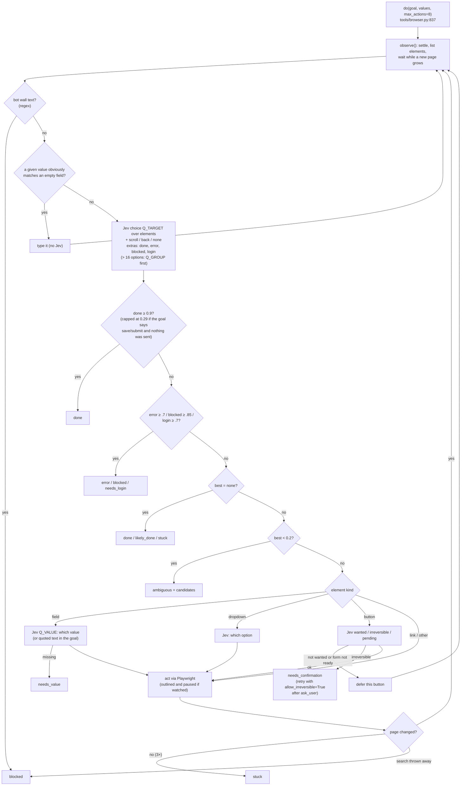
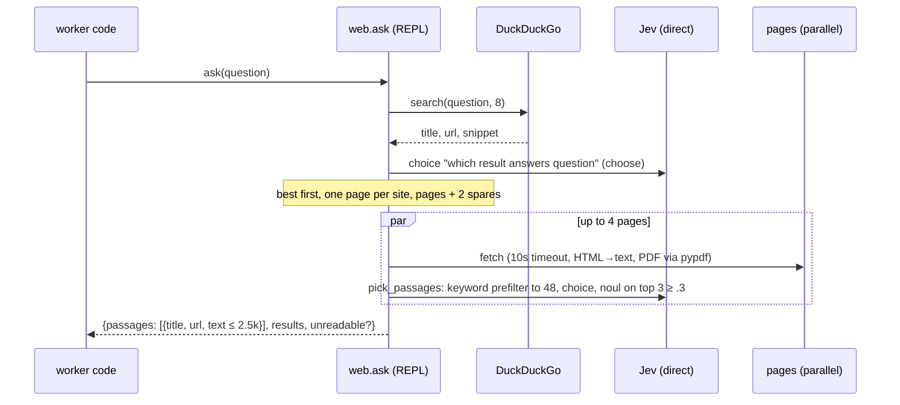
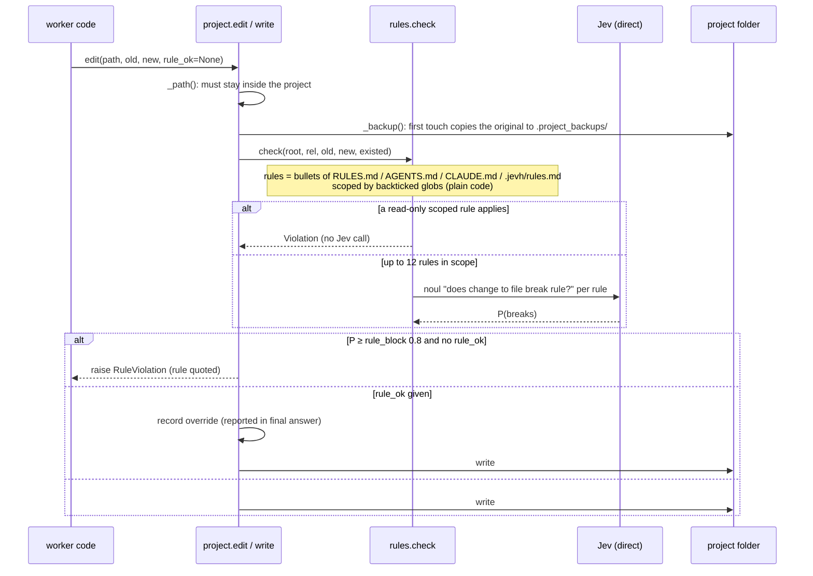

# 08 · Tools and their own Jev loops

Tools are Python modules imported into a worker's REPL under their name (`init` op,
`repl/server.py:364`). Jev picks per task which tools' **guides** go into the prompt (step
`tools`). All of the persona's tools are importable either way. The tools run inside the REPL
process. Several of them run their own Jev loops, talking straight to the adapter
([02](02-jev-decisions.md#tool-side-decisions-inside-the-repl-recorded-as-kind-jev_tools)).

| Tool | Module | Talks to | Jev loop | Harness callbacks |
|---|---|---|---|---|
| `browser` | `tools/browser.py` | Chromium via Playwright (own thread) | `do()`: pick element / value / option, button checks, done-checks | `look` → the worker's model sees a screenshot |
| `web` | `tools/web.py` | DuckDuckGo HTML, any page | result ranking, passage picking | — |
| `project` | `tools/project.py` + `tools/rules.py` | the user's project folder, shell | `find` / `find_files` ranking; rule enforcer on every edit | — |
| `nango` | `tools/nango.py` | Nango API proxy → the user's apps | — | `ask_user` for every change |
| `comfy` | `tools/comfy.py` | ComfyUI `:8188` | — | — |
| MCP | `mcp.py` (in the harness) | stdio JSON-RPC servers | `mcp_rank` / `mcp_fits` at task setup | `mcp(key, **args)` callback |

## browser.do(goal): the Jev-driven browser loop

The worker states **one outcome**, and Jev picks every click. The worker's model never reads a
page snapshot. Each call runs on the browser's own thread (`_run`, `tools/browser.py:1283`).

Every result is `{status, goal, url, title, actions, note, page (1.2k), p, jev_calls,
jev_seconds, seconds}`. When Jev couldn't finish, it adds `candidates` (numbered elements), so the
worker can act itself with `browser.click(i)` / `fill(i, text)` / `select(i, option)`.

`browser.test(url, steps, expect)` runs `do()` per step with `act_first`, then checks `expect`
with two nouls (`shows ≥ .55` and `holds ≥ .6`) and reports JS and console errors. With the
dashboard's "Watch browser" on, the browser runs with a CDP port (`JEVH_BROWSER_DOCK`), and the
dashboard mirrors it and passes the user's clicks back ([10](10-observability.md)).

## web.ask(question)

## project: edits go through the rule enforcer

`project.changed()` lists the touched files. `final()` sends that list to the gate, which runs
the project's tests and reviews risky diffs against the backups ([07](07-final-gate.md)).

## nango: changes are approved by the user, from inside the tool

`nango.request` (`tools/nango.py:252`) sends every call through Nango's `/proxy` with the
connection's key, so no token reaches a prompt. A method that isn't a read (`is_read`), or any
call with `base_url=`, goes through `_approve` (`tools/nango.py:225`). `_approve` calls the REPL's
own `_call("ask_user", …)` directly, so the worker's code can't answer for the user. The options
are `Allow`, `Allow all <app> changes this task`, and `Don't allow`. `tools.nango_writes: deny`
refuses all changes, and `allow` skips the question.

## MCP (`mcp.py`)

`McpHub` starts each configured server on first use (`initialize`, `tools/list`), and the servers'
tools form one catalog keyed `server.tool`. At task setup Jev picks at most 3 of them
(`mcp_rank`, `mcp_fits`), and their signatures go in the prompt. The worker calls
`mcp("server.tool", arg=…)` → callback → `_mcp_call` checks the persona's `mcp` globs →
`McpServer.call` → `tools/call` JSON-RPC → text content.
