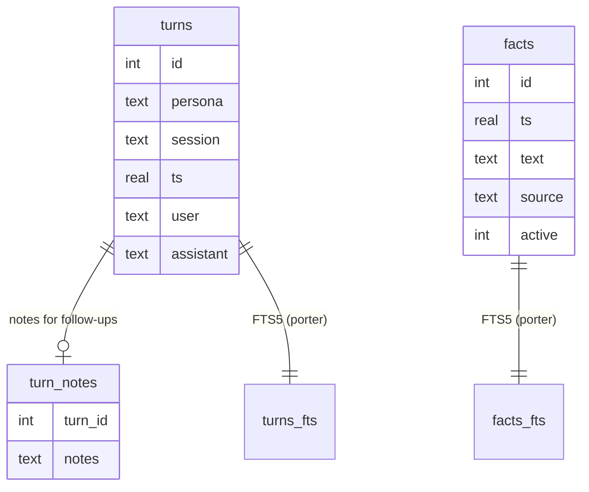
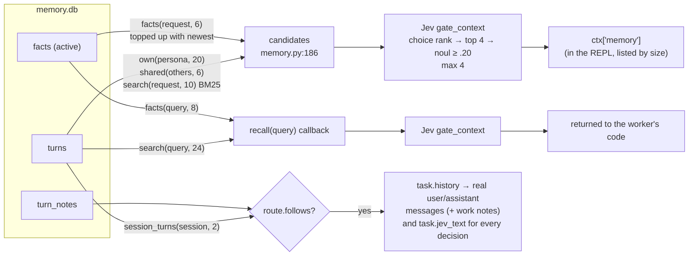
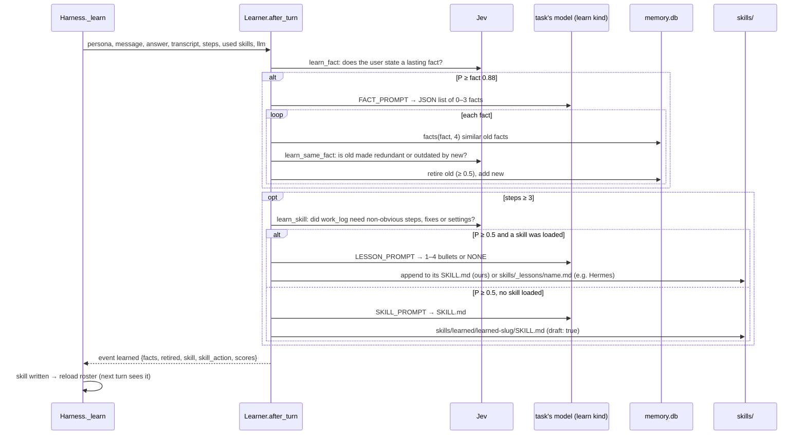

# 09 · Memory and learning

Nothing from the past reaches a worker unless Jev lets it through. There are two ways in: the
**memory gate** at task setup, and `recall()` when the worker asks. A third path, for
**follow-ups**, sends the last exchange as real conversation turns.

## Storage (`memory.py`)

`Memory.append` (`memory.py:111`) also writes one JSON line to `<persona>.jsonl` and
`timeline.jsonl`. On a fresh `memory.db`, `timeline.jsonl` is imported.

## Three paths from the past to a worker

- Candidates that are already in the follow-up history are removed first (`orchestrator.py:439`).
- `task.jev_text` (`bus.py:29`) is what every per-task Jev decision judges. For a follow-up it is
  the earlier exchange plus "Latest message: …", so "4 days, full gym" still gets the workout
  skill.
- Failed turns aren't written. A stopped turn is written with "[stopped by the user before
  finishing]", so a redirect has context.

## Learning after a turn (`learn.py`)

Runs on a background thread after a turn that ended in `final` or `plain`. It uses the model that
just ran the task, which is already loaded, so there's no LM Studio swap. A new turn sets
`learner.cancel`, and any learning call in progress is dropped (`Cancelled`).

Learned skills are drafts until the user approves them in the dashboard's Memory tab
(`/api/skills/review`). A draft's body goes into prompts with a "treat as hints, check its claims"
header. `remember(fact)` from the REPL uses the same `_store_facts` path, retiring outdated facts.
