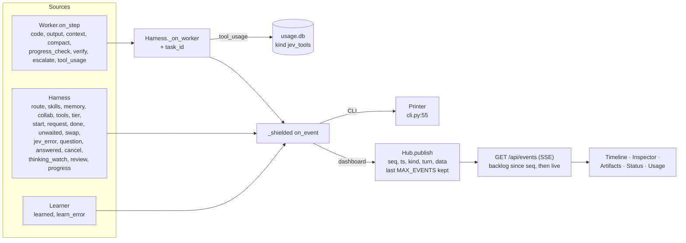
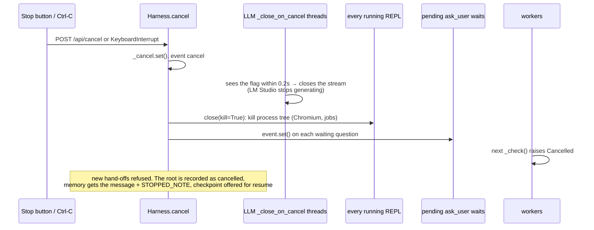
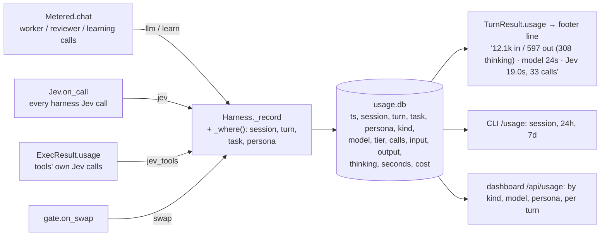

# 10 · Control and observability

## The event bus

Every part of the harness reports what it does through one callback, `on_event(kind, data)`. It
is wrapped by `_shielded` (`orchestrator.py:84`), so a bug in a display handler can never stop the
work. Worker events go through `Worker.on_step` → `Harness._on_worker` (`orchestrator.py:582`),
which adds `task_id` and turns `tool_usage` into a usage row instead of an event.

### Event catalog

| Event | Emitted by | Data | Shown in |
|---|---|---|---|
| `turn_start` / `turn_done` / `turn_error` | `Hub.start_turn` (`web/server.py:120`) | turn record (answer, tasks, trace, usage) | chat, timeline |
| `route` | `_turn` | `RouteDecision` (probabilities, continues, replies, follows, reason) | Inspector, CLI |
| `skills` | `run_task` | `SkillDecision` (probs, none, fits, picked) | Inspector |
| `memory` | `run_task` | `MemoryDecision` (kept, scores) + candidate count | Inspector |
| `collab` | `run_task` | `CollabDecision` (suggested, scores, complexity) | Inspector |
| `tools` | `run_task` | `ToolDecision` (tools, scores, mcp, mcp_probs, mcp_fits) | Inspector |
| `tier` | `run_task` | `TierDecision` (tier, p_strong, reason) | timeline colour |
| `start` / `done` | `run_task` | task (+ model) / task + `WorkerResult` | timeline lanes |
| `request` | `_start_request` | sub-task, approved, scores or reason | timeline hand-offs |
| `unwaited` | `run_task` | a hand-off's result the parent never waited for | timeline |
| `code` / `output` | Worker | step, code / output, error | chat (verbose), CLI `/verbose` |
| `context` | `_report_context` | estimated tokens by part, limit | context ring |
| `compact` | `_compact` | tokens before/after, full, notes, dropped | timeline, CLI |
| `progress_check` | `_stalled` | circles, stuck, strike, new_pages | Inspector, CLI |
| `thinking_watch` | `_watch_fn` | p (testable), search, chars | Inspector |
| `progress` | LLM `on_progress` | persona, chunks, thinking | live token counts |
| `verify` | `_bounce` | ok, problems, checks, scores, bounced | Inspector, CLI |
| `review` | `_verify_fn` | persona, tier of the reviewer | Inspector |
| `escalate` | `_bounce` | the strong model swapped in | timeline, CLI |
| `swap` | LM Studio gate | unloaded, loaded, seconds | timeline markers, Status |
| `question` / `answered` / `question_timeout` | `_ask_user` | question id, options / answer | chat buttons |
| `cancel` | `Harness.cancel` | number of workers | chat |
| `jev_error` | `_safe` | step, error | CLI, Inspector |
| `learned` / `learn_error` | Learner | facts, retired, skill, scores / error | Memory tab, CLI |
| `review_flag` / `review_start` / `review_done` / `review_error` | dashboard review API (`web/server.py`) | flag id and session; verdict / error | Review tab |

## Stop: one flag reaches everything

## ask_user: a worker waits for the user

`ask_user(question, options)` in the REPL → callback → `Harness._ask_user`
(`orchestrator.py:345`). This registers a `PendingQuestion` (up to 8 options), emits `question`,
and waits in 0.5s ticks for `answer()` (dashboard `/api/answer`, or the CLI prompt), up to
`limits.ask_timeout` (30 min). On timeout the worker gets "(no answer from the user … continue
with your best judgement)". Its REPL (variables, an open browser page) stays alive the whole time.

## Usage tracking (`usage.py`)

Cost is computed only for models priced under `prices:` in config.

## Where to watch each part live

| Part | Watch it in |
|---|---|
| Routing, skills, memory, tools, tier, collaborators, approvals | dashboard **Inspector** (select a turn); CLI `/trace` shows raw Jev answers |
| Every task and hand-off over time | dashboard **Timeline** (one lane per task, tier colours, swap markers) |
| A step's thinking as it streams | `…/task folder/thinking/step-NN.txt`, dashboard `/api/thinking` |
| Code and output per step | CLI `/verbose`; `code` / `output` events |
| Context size and compaction | context ring (`context` event); `compact` events |
| Stalls, pauses, gate bounces | `progress_check`, `thinking_watch`, `verify`, `escalate` events |
| The browser tool | "Watch browser": a window, or docked in the dashboard's Browser panel (CDP mirror, `/api/browser/frame`, `/api/browser/input`) |
| LM Studio, Jev adapter, semif, ComfyUI, GPU | dashboard **Status** (`/api/status`); CLI `/jev` |
| Deliverables | dashboard **Artifacts** (`/api/artifacts`, `/api/file`: HTML in a CSP sandbox) |
| Memory, facts, learned skills | dashboard **Memory** tab (`/api/memory`, `/api/skills/review`, `/api/memory/forget`); CLI `/facts`, `/forget` |
| Cost and time | footer line, CLI `/usage`, dashboard **Usage** tab |
| A task's full conversation | `…/task folder/checkpoint.json` |

## Dashboard security (`web/server.py`)

The agent runs code, so the dashboard binds to 127.0.0.1 only. It rejects foreign `Host`
headers, requires a per-launch token on every `/api` call, and refuses POSTs from other origins.
It serves files only from the workspace, with a CSP sandbox on HTML.
