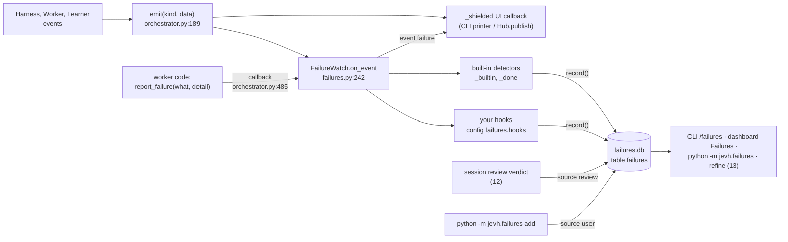
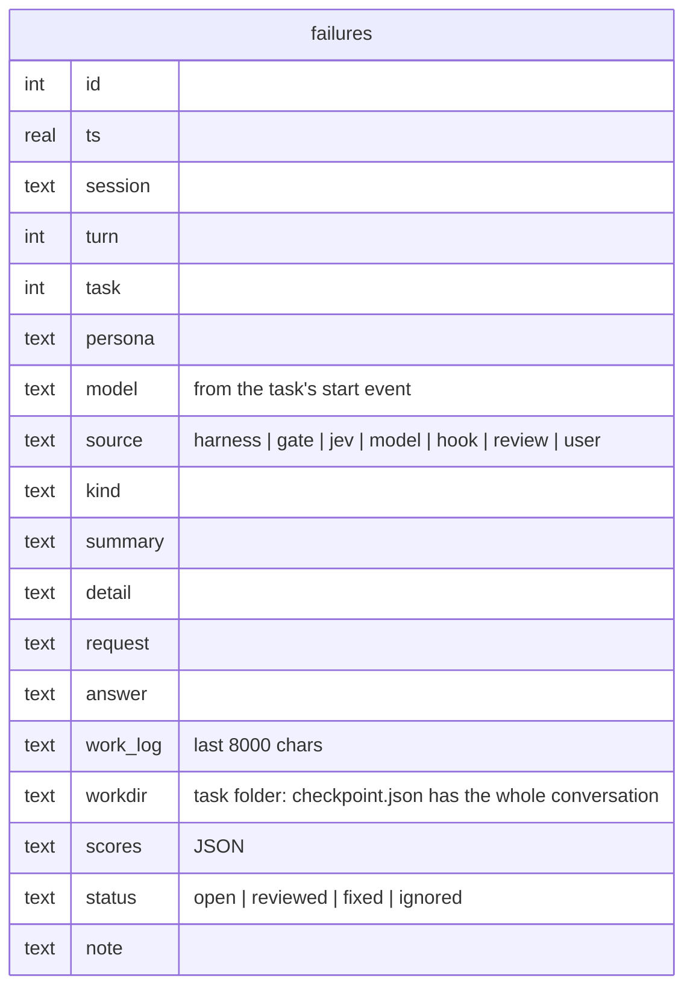
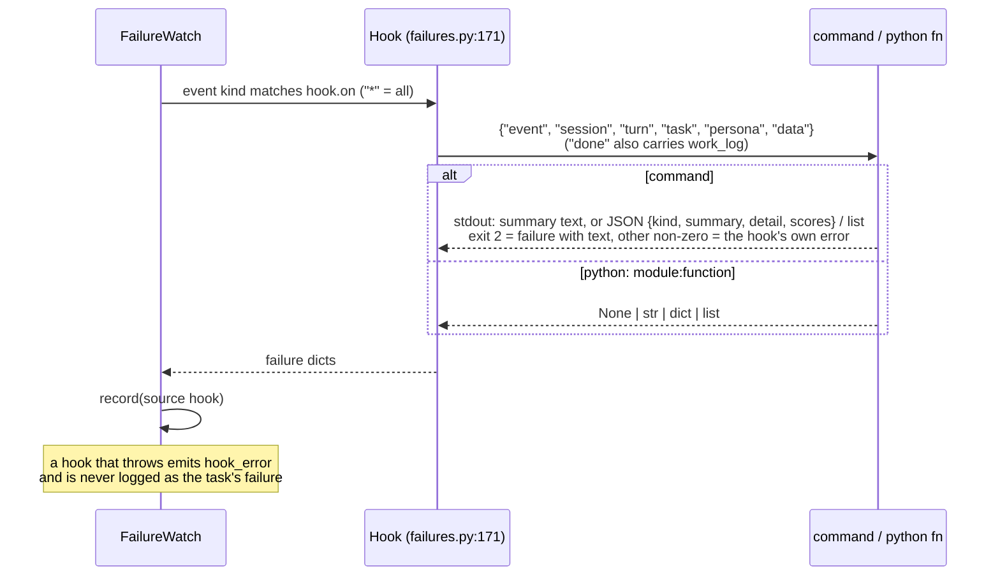

# 11 · The failure log

Every way a task goes wrong is written to `workspace/failures.db` so the harness can be improved
from it later (prompts, thresholds, tools, skills). Logging never changes how a task runs. A
`FailureWatch` reads the same events the UI gets and writes down what failed
(`failures.py:242`).

## Where it sits

The harness's `on_event` used to go straight to the UI. Now `Harness.__init__` wraps it
(`orchestrator.py:184-192`): every event goes to the UI first, then to the failure watch.

## What gets logged, and from where

| `source` | `kind` | Trigger | Code |
|---|---|---|---|
| `harness` | `crash`, `step_limit`, `stalled`, `stopped_by_user` | a task ended with `stopped` = error / max_steps / stalled / cancelled | `STOPS`, `failures.py:60`; `_done` `:336` |
| `harness` | `going_in_circles` | a `progress_check` event with `stuck` | `_builtin`, `failures.py:304` |
| `harness` | `reply_cut_off`, `empty_reply` | an `output` error event from the worker | `_builtin` |
| `harness` | `jev_unavailable` | a `jev_error` event (`_safe` fell back) | `_builtin` |
| `harness` | `handoff_refused` | a `request` event with `approved: False` (logged on the parent task) | `_builtin` |
| `gate` | `gate_bounce` / `gate_unresolved` | a `verify` event that wasn't ok: sent back, or accepted with problems listed | `_builtin` |
| `jev` | `gave_up` / `missed_request` | after a task ended normally, Jev step `failure_check` (below) | `_done` |
| `model` | `reported` | the worker called `report_failure(what, detail)` | `report`, `failures.py:279` |
| `hook` | the hook's name, or the kind it returns | a hook in `failures.hooks` flagged the event | `_run_hook`, `failures.py:364` |
| `review` | `review_failure` | a session review's verdict was "failure" | [12](12-session-review.md) |
| `user` | anything | `python -m jevh.failures add <kind> "
" --workdir <task folder>` | `from_workdir`, `failures.py:393` |

### The Jev check after a task

When a task ends normally (`final` or `plain`) and `failures.jev_check` is on, the watch asks Jev
one more question set. The state is `{request, answer, artifacts (file names), work_log}`.

| Noul | Logs | Threshold |
|---|---|---|
| `gave_up`: "Does `answer` say that `request` could not be done, or was only partly done?" | `gave_up` | `failure_gave_up` 0.85 |
| `missed`: "Do `answer` and the files in `artifacts` fail to deliver what `request` asked for?" | `missed_request` | `failure_missed` 0.85 |

The check sees the files handed over. When it saw only the answer text, correct "give me a CSV"
runs were logged as `missed_request`.

## A row

A row holds everything needed to study the failure without the session: the request, the answer,
the work log, the persona, the model, and the task's folder.

## Hooks: your own detectors

## Where to see it

| Place | What |
|---|---|
| CLI | each failure prints as it's logged; `/failures [n \| kind]` lists recent ones |
| Dashboard | Failures view (`/api/failures` with counts by kind, source and persona; `/api/failures/status` to triage) |
| Command line | `python -m jevh.failures [--kind k] [-n 50]`, `export failures.jsonl`, `status <id> fixed "note"`, `add …` |
| Events | `failure` `{id, source, kind, summary, persona, task}`, `hook_error` |
