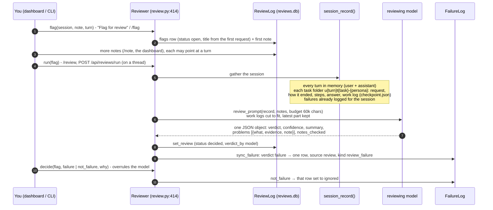
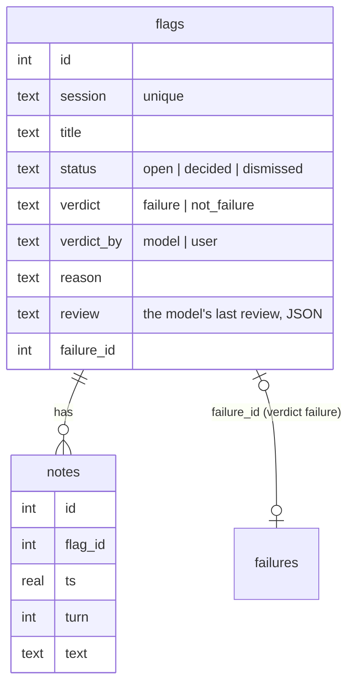

# 12 · Session review

Some failures no detector can see: the totals were wrong, a source was never cited, the plan
ignored what you said. Session review lets you **flag a session**, write notes on what looked
wrong, and have a model read the whole session against those notes. The model lists the problems
and gives a verdict. A "failure" verdict also goes into the failure log, so refinement
([13](13-refine.md)) works on it like any other failure.

## The flow

| Step | Code |
|---|---|
| What the model reads | `session_record`, `review.py:218`; `review_prompt`, `review.py:300` |
| Parsing the reply (first JSON object; verdict must be `failure` or `not_failure`) | `parse_review`, `review.py:320` |
| Which model reviews: `review.model`, else `--model`, else `models.strong`, else the default persona's; never `think: unlimited`, budget `review.max_tokens` (32,768) | `reviewer_block`, `review.py:339` |
| Running it | `Reviewer.run`, `review.py:441` |
| Keeping the failure log in step with the verdict | `sync_failure`, `review.py:380` |

## Storage (`workspace/reviews.db`)

## Where to use it

| Place | Commands |
|---|---|
| CLI | `/flag [note]`, `/note <text>`, `/flags [all]`, `/review [id]` |
| Dashboard | "Flag for review", notes, run, verdict (`/api/reviews`, `/api/reviews/flag`, `/note`, `/run`, `/api/sessions`) |
| Command line | `python -m jevh.review [sessions \| flag \| note \| show \| run \| verdict \| dismiss]` |
| Events | `review_flag`, `review_start`, `review_done`, `review_error` (dashboard) |
