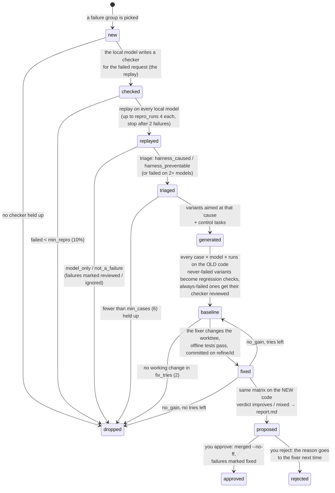
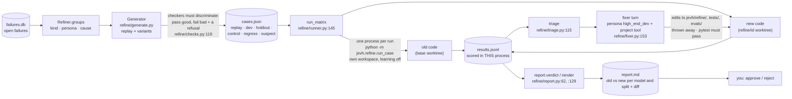

# 13 · Refinement: from logged failures to a tested fix

`python -m jevh.refine nightly` turns open failures into harness changes you approve. A local
model writes tests for the failure, a local model changes a separate copy of the harness, and both
versions run the same tests on every local model. You get a report with the numbers and the diff,
and nothing is merged until you approve it.

Everything runs on **local models** (`runner.is_local`): no Claude API, no keyed cloud endpoint.
The fixer works in a **git worktree** on branch `refine/<id>`, never in the running harness.

## The stages of one attempt

One attempt per failure group: the same kind, persona and cause (`Refiner.groups`,
`refine/loop.py:198`). Each attempt lives in `workspace/refine/<id>/` and saves its stage after
every step, so a night cut short carries on the next night. The cheap questions come first: does
it happen again, and is it the harness's to fix?

## What crosses between the parts

### Why the scores can be trusted

- **The checkers don't belong to the harness.** A checker is JSON the local model writes
  (`contains`, `regex`, `number`, `json_equals`, `artifact`, `python`, `jev`, `all` / `any`;
  `refine/checks.py`). It's kept only if it passes a good answer and fails a bad one and a plain
  refusal. So a fix that only makes the final() gate more lenient can't score as an improvement.
- **The fix can't change how it's scored.** Runs execute in the code tree being tested, but scoring
  happens in the refiner's own process. The fixer's edits to `jevh/refine/`, `tests/` and `evals/`
  are thrown away (`PROTECTED`, `refine/fixer.py:20`).
- **The fixer sees only the dev cases.** Held-out cases show whether the fix generalizes. Control
  tasks (`evals/refine_controls.json`) catch a fix that breaks something else.
- **Rare failures get enough runs.** The replay runs often enough to expect `repro_target` (3)
  failures on the old code, up to `max_runs` (8) per model.
- **"Cost" failures are scored on bounces.** For `cost_kinds` (`gate_bounce`: a correct answer the
  gate sent back), the measure is gate bounces per run, which must halve. A cost guard
  (`evals/verify_cases.py --guard`) checks that the gate didn't get more lenient.

### The verdict (`refine/report.py:62`)

| Verdict | Meaning |
|---|---|
| `improves` | the failing cases pass clearly more often (≥ `min_gain` 0.15, Fisher test), held-out cases don't do worse, no model loses more than `control_slack` (1) control + regression runs |
| `mixed` | it helps overall, but a held-out split or some model's controls got worse |
| `no_gain` | anything else: another fix try, or the attempt is dropped |

## Commands (`python -m jevh.refine`)

| Command | Does |
|---|---|
| `groups` | open failures grouped by kind, persona and cause |
| `models` | the local models tests run on, and the one that writes tests and fixes |
| `nightly [--until 07:00 \| --hours 8]` | carry on unfinished attempts, then start new ones |
| `start <failure id>`, `resume <attempt id>` | one attempt now |
| `status`, `report <attempt id>` | every attempt's stage; the approval report |
| `approve <attempt id>` | merge the branch; its failures are marked fixed (`refine/loop.py:542`) |
| `reject <attempt id> "why"` | drop it; the reason is shown to the fixer next time (`refine/loop.py:564`) |
