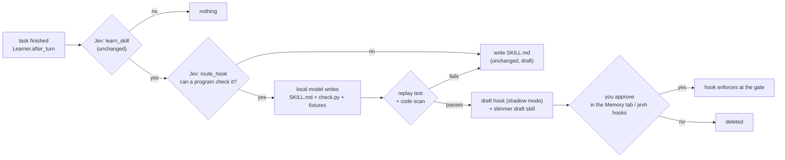

# 14 · Skill / hook router (proposed)

**Status: design. Nothing here is built, tested or tuned.** Line numbers are for the commit this page
was written on; search for the function name if they drift.

> **Untested and untuned.** The router's first question (`HOOK_Q`, `jevh/learn.py`) and its threshold
> (`thresholds.route_hook`, 0.85) are first guesses that have **never been run against a live Jev**.
> Nothing calls them yet. What exists is the tuning set and its tests: 42 tuning and 15 held-out
> labelled work logs (`evals/hook_route_data.py`) and a sweep that recommends a threshold
> (`python evals/hook_route_cases.py`; offline tests in `tests/test_hook_route_cases.py`). Run the
> eval against Jev, set `route_hook` from the sweep, and only then build the router on it. The
> "NOT TUNED" notes in `config.yaml`, `jevh/learn.py` and the eval come off when the scores are saved.
> Gate hooks themselves (section 1) have no code yet either.

A skill's body is injected into the worker's prompt every time Jev picks it (`skills.py`,
`Skill.body`). Many skills are really rules a program can check on the finished work. A rule
that is checked at the final() gate costs the worker nothing while it passes, and one short message
when it doesn't. This page adds two things:

1. **Gate hooks**: checks that run inside the final() gate and can send work back. Today's hooks
   (`failures.hooks`, `failures.py:2`) only observe; they never change how a task runs.
2. **A router in the learning step** that decides, for a newly learned skill, whether it should be
   a skill, a hook, or both, and a one-off split of `frontend-design`.

Out of scope for now: lessons appended to an existing skill (`Learner._lessons`), a pre-tool guard
(blocking a REPL call before it runs), fixing tools through `jevh.refine`, and auditing the other
built-in skills.

## Where each piece sits



A hook that can't be written or doesn't pass its test falls back to exactly what the harness does
today (a draft skill), so the router can only add to what is learned, never lose it.

## 1. Gate hooks

A hook is a folder, like a skill:

```
hooks/<name>/hook.yaml     name, description, draft, applies, covers
hooks/<name>/check.py      the check
hooks/<name>/cases/        fixtures: good/ passes, bad/ must be flagged
```

```yaml
name: frontend-design-checks
description: Static checks on a delivered web page (tokens, dark mode, viewport, focus states).
draft: false
applies:
  artifacts: ["*.html", "*.htm"]    # runs only when the task delivered a matching file
  personas: []                       # empty = any persona that runs the gate
covers:                              # what it enforces, shown in the approval view
  - dark-mode block redefines the tokens
  - visible :focus-visible states
```

`check.py` speaks the protocol the failure hooks already use, so one script can serve both. The
event JSON arrives on stdin; each line printed on stdout is one problem; no output means pass;
any other failure is the hook's own error and never blocks work:

```json
{"request": "...", "answer": "...", "artifacts": ["/abs/path/index.html"],
 "work_log": "...", "project": null, "changed": []}
```

**Gate integration.** `Verifier.check` (`verify.py:234`) already collects `v.problems` from file,
render, project and answer checks. Gate hooks join them after the file and render checks and
before the answer check:

```python
for hook in self.hooks.matching(artifacts, persona):
    probs, note = hook.run(ctx)                 # subprocess, timeout, JSON on stdin
    v.problems += [f"[{hook.name}] {p}" for p in probs]
    v.checks[f"hook {hook.name}"] = note
```

Nothing else changes. A problem becomes the worker's "Not accepted yet: …" message with its REPL
state intact (`Worker._bounce`, `worker.py:966`), counts against `verify.max_bounces` (2), and after
that the answer is accepted with the problem listed. A bad hook can cost two bounces on a task,
never an unbounded loop. `_verify_fn` (`orchestrator.py:661`) needs to pass the persona through;
hooks only run where the verifier does (`persona.code` and `verify.enabled`).

**Where hooks live.** Built-in hooks that change the harness for everyone are tracked in
`hooks/`. Yours and learned ones go in `~/.jevh/hooks/` (`learned/` for the router's), by the same
rule as skills (AGENTS.md): add `hooks_dirs` next to `skills_dirs` (`config.py:86`, `PATH_LISTS`),
and teach `jevh home` and `home.py` to move `hooks/learned` there. A name in `~/.jevh/hooks/`
replaces a built-in one.

**Shadow mode.** A hook with `draft: true` runs at the gate but never bounces: it emits a
`hook_gate` event (hook, would-have-flagged, problems, shadow: true) so the dashboard and the
approval view can show what it would have caught on real tasks. Approving drops the flag, as with
learned skills (`web/server.py:570`).

## 2. The router

In `Learner.skill` (`learn.py:217`), after `learn_skill` passes and no skill was in use (the
`_create` path):

1. **Ask Jev** (`route_hook`, a noul like the others): *"Could the main requirements of this work be
   checked by a program that reads the finished files, the answer or the work log, without
   understanding the request?"* Below `thresholds.route_hook`, write a skill as today.
2. **Ask the local model** for the SKILL.md as today, then for a `check.py` and fixtures covering
   the checkable steps, and which steps they cover.
3. **Test it** (below). A pass keeps the hook; a failure throws the hook away and keeps the skill.
4. **Slim the skill.** The covered steps are removed from SKILL.md and replaced with one line,
   e.g. "A gate check enforces: dark-mode tokens, focus states, viewport. Fix what it reports." The
   worker isn't surprised by a bounce, and the context cost is one line instead of the rules. If
   nothing is left, the skill is dropped and only the hook is kept.

The model that writes the hook is a local one (the same `llm` `Learner` already gets); Claude isn't
involved, as in `jevh.refine`.

### The test a hook has to pass

No hook runs at the gate, even in shadow mode, until it has passed all of this. A learned hook's
"bad" example can't come from the task that produced it: by the end of that task the worker has
usually fixed the mistake. So the model writes fixtures, and the harness checks:

| Check | Pass condition |
|---|---|
| Code scan | `check.py` parses; no network, subprocess, delete or write calls (AST denylist) |
| Bad fixtures | every `cases/bad/*` is flagged, and each names the rule it breaks |
| Good fixtures | every `cases/good/*` passes |
| Minimal pairs | each bad fixture is a good one with a single violation added, so a flag can only come from that rule |
| Odd inputs | none of these crash it or get it flagged: an empty file, a binary file, a 5 MB file, non-UTF-8 bytes, malformed markup, a missing path, a directory instead of a file, an artifact list with no matching file, unicode and emoji. A crash is the hook's error and fails the test |
| Deterministic | two runs on the same input give the same output |
| No side effects | the folder it ran in is byte-for-byte the same afterwards; it wrote nothing |
| Past tasks | of recent finished tasks it applies to that have no failure rows, at most 10% are flagged; the flagged ones are listed for you, because a flag may be a real miss |
| Speed | each run under a few seconds, including on the 5 MB input |

A failed test throws the hook away and keeps the skill, as in the diagram above.

### Approval

The approval view for a hook shows: what it covers, the code, the fixtures, which past tasks it
would have flagged, and its shadow-mode record. Approve (drops `draft`) or delete, in the Memory
tab and with `jevh hooks` (list, approve, delete), next to the skill flow.

## 3. The first conversion: `frontend-design`

Of its eight items, these are checkable from the page text with no judgment:

| Item | Check |
|---|---|
| 2. Tokens | `:root` defines `--` custom properties; a `prefers-color-scheme: dark` block redefines them |
| 3. Layout | `<meta name="viewport">` present |
| 5. Components | `:focus-visible` rule exists when the page has buttons or links; inputs have a `<label>` or `aria-label` |
| 4. Type | exactly one `<h1>` (from item 1) |

Contrast (item 6) and no horizontal scroll need a rendered page; they can come later using
Playwright inside `check.py`. Structure, type choices, data UI and images stay in the skill, because
they need taste, not a program. Honest estimate: the skill shrinks by about a third (it's already
short), so here the gain is mostly reliability: a small model forgets the dark-mode block less often
when something checks for it.

## Risks and open items

- **Generated code runs before you approve it.** The replay test and shadow mode both execute
  `check.py`. Agreed: the code scan, a subprocess with a timeout and no network, and a read-only view
  of the files are enough, on the condition above: a hook is thoroughly tested before it runs anywhere
  but the test. There is no hard sandbox.
- **`route_hook` is untuned and `HOOK_Q` is untested on a live Jev** (see the note at the top).
  The tuning set is in `evals/hook_route_data.py`: cases of five kinds (clear yes, mixed, clear no,
  lookalikes that read like yes, and odd inputs: a log cut by the window, a task longer than the
  window, other languages, emoji, a vague task, text in the log that tries to steer the scorer). It is
  swept the way `evals/learn_cases.py` sweeps `learn_skill`, with the policy that a false positive
  (a wasted model call and a hook that may flag good work) costs more than a miss (a draft skill, as
  today): zero false positives first, then recall, a margin above the highest non-checkable score, and
  the held-out cases scored once at the chosen threshold.
- **A bounce costs a model turn.** A rule that is easy to follow up front is cheaper in the skill's
  one-liner (or the persona) than as a hook, which is why the slimmed skill keeps the line.
- **False positives.** The 10% past-task limit, shadow mode and the two-bounce cap are the guards;
  hook problems name the hook so the failure log (`gate_bounce` rows) shows which one is noisy.

## Build order

1. `jevh/hooks.py`: load, match, run a hook; `hooks_dirs`; the `Verifier.check` call; shadow mode;
   the `hook_gate` event; `tests/test_hooks.py` (offline, scripted models: match, enforce, shadow,
   broken hook, timeout, two-bounce cap).
2. `hooks/frontend-design-checks/` and the slimmer `frontend-design` skill, with fixtures.
3. The router, only once `route_hook` has been tuned: the hook-writing prompt, the replay test,
   skill slimming, tests with a scripted local model. (Done already: the `HOOK_Q` placeholder, the
   threshold placeholder, `evals/hook_route_cases.py` and its data, `tests/test_hook_route_cases.py`.)
4. Approval: Memory tab list and approve/delete, `jevh hooks`, `/hooks` in the CLI, `home.py`.
