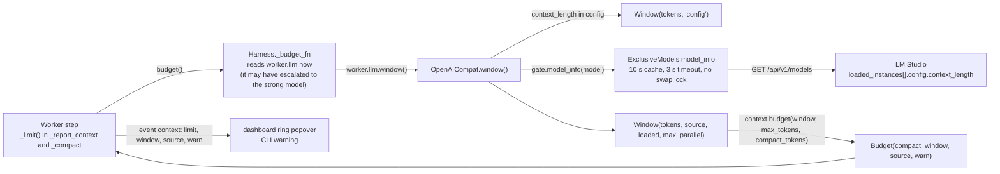

# 17. Context length: what the model is loaded with, and where compaction starts

Status: built (`jevh/context.py`, plus `lmstudio.py`, `llm.py`, `worker.py`, `orchestrator.py`, the dashboard and the CLI)
and checked on 2026-10-04 against the LM Studio on this machine (Qwen3.8 27B loaded with 100096 tokens;
`lms ps` says the same): `python evals/bench/context_detect.py` passes 13 of 13 checks, and `tests/test_context.py`
holds 55 offline tests. **Not run:** a model reloaded with another context while a task runs (that would have changed
the LM Studio a live session was using; a fake server covers it in the tests), a long task compacting at the detected
window on a live model, and any server but LM Studio (see "Other servers").

## Why

The harness assumed one number for every model: `limits.compact_tokens: 60000`, written by hand because Qwen has 100k of
context loaded in LM Studio (60% of it). A model loaded with 32k would overflow long before 60k; one loaded with 262k
would condense far too early; and nothing told you which. Hermes Agent, running on the same LM Studio, asks LM Studio what a
model is loaded with. The harness now does the same.

## What LM Studio says

`GET /api/v1/models` (the endpoint the one-model gate already uses) lists every model. For this machine, trimmed to what
matters (the full answer is saved as `tests/lmstudio_models.json`):

| model | loaded | `loaded_instances[].config.context_length` | `max_context_length` | `parallel` |
|---|---|---|---|---|
| `qwen3.8-27b` | yes | **100096** (what was set in LM Studio's load settings) | 262144 (what the model supports) | 2 |
| `ornith-1.5-35b-a3b` | no | | 262144 | |
| `google/gemma-4-12b-qat` | no | | 262144 | |

`lms ps --json` reports the same `contextLength` (100096) and `maxContextLength`. The number that counts is the loaded
one, not the maximum. A model that is not loaded has no context yet: LM Studio decides it when it loads the model.

## What Hermes does, and what was taken

Read in its source on this machine (`agent/model_metadata.py`, `agent/context_compressor.py`):

- LM Studio: `GET <server>/api/v1/models`, match the model by key or id, take the first loaded instance's
  `config.context_length` ("the runtime value"). The answer is memoised for 30 s, successes only, so a reload with another
  context is picked up and a failed probe is retried.
- An explicit `context_length` in config wins: "user knows best".
- The compression trigger is a share (50%) of the window **minus the room kept for the reply** (`max_tokens`), with floors
  and caps so that small windows still trigger.
- Other servers: llama.cpp `/props` (`default_generation_settings.n_ctx`), vLLM `max_model_len`, and a parse of the
  overflow error for the real limit.

Taken: the LM Studio query, a short cache, config winning, and the reply's room coming out of the window. Different: the
harness asks before **every step** (a cached answer, so about one request in ten seconds), keeps the last answer if
LM Studio cannot be reached for a while (a hiccup must not change the limit mid-task), and treats "not loaded yet" as
unknown, not as the model's maximum. Left out: a disk cache, the other servers' probes and the overflow parse (below).

## Where a model's window comes from

First match wins; the code is `OpenAICompat.window()` (`llm.py`):

0. **A llama.cpp server** (any provider without the LM Studio gate that answers `GET /props`; added 2026-10-07 when Jed
   moved Qwen to llama-server): `default_generation_settings.n_ctx`, what one slot can use (76,032 for `-c 76000`, 2 slots,
   unified KV), via `context.server_props()`, 2 s timeout, reused for 10 s. It wins over `context_length`: it is what each
   request can really use, so the reason to override (a split KV cache) does not apply. `context.detect: false` turns it off.
1. **`context_length` in config**, in the model's block (a persona's `model:`, `models.fast`) or its provider. It tells the
   harness what to assume. It does not change what LM Studio loads.
2. **LM Studio**, for a provider with `exclusive: true` (the one the gate manages), unless `context.detect: false`:
   `ExclusiveModels.model_info()` (`lmstudio.py`), 3 s timeout, never under the swap lock (a swap can hold it for minutes), the
   answer reused for 10 s per model and, if LM Studio cannot be reached, kept for 10 minutes.
3. **Unknown**: the model nothing can be asked about, or LM Studio down: `limits.compact_tokens` stands.

A persona with a fallback model (`WithFallback.window()`) has the smaller of the two windows, since a failed call is
repeated on the fallback with the same messages. If either is not known yet, so is the pair: one model's window says
nothing about the other.



## What the harness does with it

Older steps condense (compaction, [05](05-stamina.md)) once the estimated prompt passes the limit:

```
room    = min(max_tokens, window / 2)        a quarter of the window if the model may think without limit (think: unlimited)
compact = max(2048, min(window × compact_at, window − room))      compact_at = 0.6
```

| window | reply (`max_tokens`) | condenses at |
|---|---|---|
| 100,096 (Qwen here) | 8,192 | **60,057** (the old hand-set 60,000) |
| 262,144 | 8,192 | 157,286 |
| 32,768 | 8,192 | 19,660 |
| 16,384 | 8,192 | 8,192 (the reply's room binds before the share does) |
| 100,096 | 65,536 | 50,048 (at most half the window is kept for a big reply) |
| 4,096 | 8,192 | 2,048 (the floor: nothing the harness can run on) |

- The limit is read every step, so a model reloaded with another context mid-task changes it from the next step, and a
  fast model that escalated to the strong one is judged by the strong model's window.
- A window below `context.min` (16,384) is flagged in the `context` event (`warn`), in the dashboard popover and as one
  yellow line in the CLI: the instructions and tools alone take several thousand tokens.
- A model that is not loaded yet, a model nothing can be asked about, or an LM Studio that is down: `limits.compact_tokens`.
  The first step of a task on a model LM Studio is about to load therefore uses it, and the next step has the real window.
- **Tests never ask a server.** The window comes from the model client, and a Harness given its own `llm_factory` (the
  scripted models of the tests) has clients with no `window()`: `compact_tokens` stands.

## Where it shows

- `jevh context` (`--json`, `--model provider:model`): what LM Studio has loaded and what each model the config puts to work
  will do. On this machine:

  ```
  LM Studio 'lmstudio' at http://127.0.0.1:1234/v1
    google/gemma-4-12b-qat             not loaded            supports   262,144
    qwen3.8-27b                        loaded with   100,096   supports   262,144   parallel 2
    ornith-1.5-35b-a3b                 not loaded            supports   262,144

  What the harness does with each model it is set to use (condense older steps at 60% of the window; limits.compact_tokens = 60,000 where the window is not known):
    lmstudio:qwen3.8-27b@q6_k              window 100,096 (asked LM Studio)  -> condenses at 60,057   [comfyui_manager, daily_assistant, ...]
    lmstudio:ornith-1.5-35b-a3b            window not known: LM Studio has not loaded it yet  -> condenses at 60,000   [fast tier]
  ```
- The dashboard: the context ring's popover says "Model window: 100,096 tokens (what LM Studio loaded it with)" and what the model
  supports; Settings' Status section, the LM Studio pill and the model chip show each loaded model with its context (`/api/status`
  `lmstudio.contexts`).
- The CLI: a warning when a window is too small; with `--verbose`, the window once per task.

## Assumptions and limits

- LM Studio's context length is for the whole model, shared by its parallel slots (its unified KV cache, the default):
  one request may use all of it. With that cache turned off, N slots get 1/N each, and LM Studio's answer does not say
  so. Set `context_length` to the per-slot number if you do that.
- The prompt size is still the harness's estimate (3.2 characters per token), not the server's count.
- `context_length` in config changes what the harness assumes, not what LM Studio loads. A model the harness loads itself
  (a swap) gets LM Studio's default context for it, which `jevh context` shows once it is loaded.
- Only the worker's compaction uses the window. Session review and refine send what they send (`max_tokens` 32768 and
  65536) without looking at it.

## Other servers

vLLM (`max_model_len` in `GET /v1/models`) and hosted models are not asked: nothing here runs them, and a
wrong number would set the limit wrong. (llama.cpp is: see above. Settings' Status section shows such a server as its own card,
marked "used by the harness" when the config's models run on it; LM Studio's card then says it is not used.) Give such a model `context_length` in its block or provider. Adding a probe means a
`window()` on its client and a live check beside `evals/bench/context_detect.py`.

## Checks

- `tests/test_context.py` (55 tests, `tests/lmstudio_models.json` is a real answer): the parsing (two instances, ties, junk values,
  embedding models, an older LM Studio without the config), the cache and its failure modes, config beating asking, the
  fallback pairs, the limit for each window, the worker following a window that changes mid-task, `jevh context`, the status
  endpoint and the CLI warning. Each of four deliberate breakages (a parser crash, a fallback sizing an unloaded model, the
  worker ignoring the window, the reply's room forgotten) made its test fail, and the browser test of the popover fails
  when the line is left out.
- `evals/bench/context_detect.py` (read-only): the harness's answer against the raw LM Studio answer and `lms ps`, the same on
  ten asks, 4 ms a question. A deliberately wrong parser made it fail (11 of 13).
