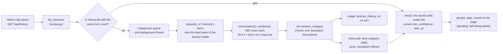

# 18. Session history: past sessions, categorized by Jev

Status: built (`jevh/history.py`, plus `jev.py`, `web/server.py`, the dashboard) and run on 2026-10-04 against the live Jev with
the 39 real sessions of this machine's workspace: all sorted in 4.2 s (median 94 ms a question), and the groups read
sensibly to the person who wrote this (a reading, not a measurement); `python evals/bench/history.py` passes 7 of 7 checks on them. The categories are scored by
`evals/session_category_cases.py`: **99 of 101 labelled sessions right at the shipped threshold, none wrong, 2 listed under
"No single field"** (51 tuning, 27 held-out, 23 hard ones; read "Checks" for what that does and does not show).
**Not run:** the tab on the dashboard you already had running (it loads this code at its next start), and Jev being down
during a live session (a fake that raises stands in for it in the tests).

## What it is

A **History** tab in the dashboard: every session the workspace has, newest first, grouped by the category Jev put it in, with a
search box. Click a session to read it (its conversation, its files, what it cost, who worked on it) and the odds Jev gave each
category. The category is the *assistant whose field the conversation is about*: the same kind of choice that routes a request,
asked once for the whole conversation.

## Why the assistants are the categories

Jev answers typed questions over options it is given; it does not write labels. The options that already exist, are described
well and are what Jev is tuned on are the assistants (personas): `Persona.description` is what routing uses. So a session about a
flask app lands under *High end dev*, one about workouts under *Fitness coach*, and a persona the harness creates later (persona
creation, [15](15-persona-creation.md)) is a new category by itself. Anything with no specialist field (small talk, calendar,
email, shopping) belongs to *Daily assistant*, the general one.

## How a session gets its category

- **Asked once, and again only when it grew.** A session is asked about the first time the tab lists it, and again when memory has
  more turns of it than when it was asked (the session you are in). Looking again asks nothing.
- **In the background.** The tab shows what it has and polls (and gets a `history` event) as Jev answers: about 0.1 s each.
  Sessions still waiting sit in a group "Jev is sorting these".
- **Outside any turn.** `Jev.session_category` asks Jev's client directly, so the question is not in a running turn's Jev trace
  and is metered as `jev_history` on turn 0, not counted among the turn's Jev calls.
- **What shows is decided at read time** from the saved odds: a session whose best category is under `history.min_confidence` is
  listed under *No single field* with its likeliest categories as tags; another category at `history.also_at` or more shows as a
  second tag. Changing either needs no new question.
- **When Jev cannot be reached** the tab says so and waits 30 s before trying again ("Sort again" tries at once).
- **When the assistants change** (a persona was created), sessions sorted before are counted as stale and the tab offers
  "Sort again"; nothing is re-asked on its own.
- A session with no request in it is *Empty sessions* and is not asked about. One whose turns all failed has no memory, so its
  lead tasks' requests are read from its folder.

The question is `SESSION_Q` in `jev.py`: "Which assistant is best suited to handle this whole conversation?", with each
assistant's description as an option.

## Where it shows

- **Dashboard → History** (the clock on the rail): groups with a count and the assistant's description, each session's first
  request, when, how many turns, a "this session" and a "flagged" badge, and tags for the other categories Jev thought of.
  Search narrows the list as you type. A session opens read-only: its conversation, the category with Jev's odds (and
  "Ask again"), its files (opened through `/api/file`), who worked on it, failures logged, and its cost.
- `GET /api/history` (the sessions, the groups, `pending`, `stale`, `error`), `GET /api/history/<session>`,
  `POST /api/history/recategorize` (one session or all). Only session ids of the form the harness makes, and only ones this
  workspace has, are read.
- `workspace/history.db`: the saved odds (per workspace, kept between runs).
- Config: `history:` in `config.yaml` (`enabled`, `min_confidence` 0.6, `also_at` 0.25, `max_requests` 6).

## Limits

- A field no assistant covers lands with the nearest one: in the eval, a cooking session went to the fitness coach (0.58, so under
  `min_confidence` it is listed as *No single field* instead). Create an assistant for the field (the harness drafts one when it
  keeps meeting requests that fit none) and "Sort again".
- A website is the designer's field and the engineer's; Jev splits it and such sessions often land under *No single field*
  with both as tags. That is the honest answer, not a failure.
- One category per session, from the conversation's first requests and last two; a long session that changes field half-way is
  filed under the field it started in or ended in.
- The tab sorts the sessions in `workspace/`; sessions from another machine are not there.

## Checks

- `evals/session_category_cases.py` (live, Jev): 101 sessions written for the eval (not anyone's real ones). At the shipped
  `min_confidence` 0.6: tuning 50 right + 1 unsure, held-out 27 of 27, hard 22 right + 1 unsure, none wrong. At 0.5 or lower one
  confidently wrong category gets through (the cooking one); at 0.7 six sessions go to *No single field*. Four wordings of the
  question were tried on all three sets: the routing-style one used here was best on every set (the "field is it mostly about"
  wording had two confident errors on the hard set; adding "anything else is the general assistant's" did worse). The hard set was
  written after the first two came out right and the wording was chosen with all three in view, so none of the three is an
  untouched test.
- `python evals/bench/history.py` (live, read-only on a copy of your workspace): 7 of 7 checks on the 39 real sessions: all sorted
  without an error, every category an assistant or one of the two special ones, a question 94 ms at the median, a second look asks
  nothing, "sort again" asks about every session, every session reads back with the turns the list says. Its committed summary
  has counts only, sorted among the assistants the repo ships (`--workspace` reads sessions from another workspace); the titles stay on your screen.
- `tests/test_history.py` (25), `tests/test_session_category_evals.py` (4) and a browser test of the tab: the reading and saving, the
  background thread (asked once, again when a session grew, Jev down, history off, an empty session, one read from its folder),
  the endpoints and their token, and the dashboard grouping, searching and reading a session. Each of five deliberate breakages (the
  question landing in a running turn's trace, `min_confidence` ignored, every session re-asked, any well-formed id accepted, no pause
  after Jev failed) made its test fail.
