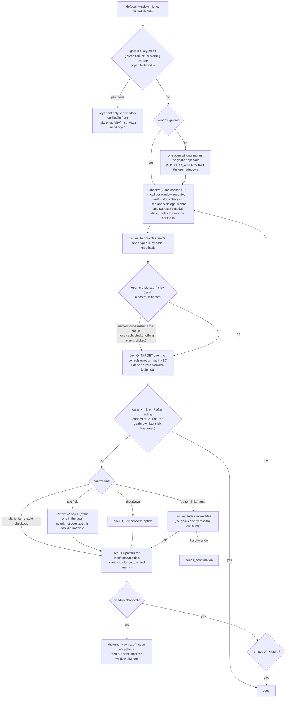

# 19 · The desktop tool

`desktop` lets a worker operate apps on the user's own Windows computer: list what is open, start an app, click,
type, press shortcuts, handle dialogs, read what a window shows. It is the `browser` tool's design (the worker states one
outcome, Jev picks every control) moved from Playwright to UI Automation, so it reaches native apps, Electron apps (the
Claude app, Telegram, LM Studio) and browser windows from outside.

**Why it exists.** Session `20261008-093548-5045` was a worker with no desktop tool at all. It got "what apps do I have
open?", "press Ctrl+N in the Claude app", "type `/rc` in the chat bar" and "send it" done, but by writing raw `comtypes`
UI Automation code itself: 37 steps to get a window list (a property condition with the wrong variant type, an interface
that would not import, a tree walk that took minutes), 17 for Ctrl+N, the same setup written again on every turn, and Jev
was not involved in any of it. The send step was caught by the app's own autocomplete, which took the Enter and rewrote
`/rc` to `remote-control `; the model found that out by reading the field back and fixed it by hand.

Files: `jevh/tools/desktop.py` (the tool: windows, the Jev loop, direct actions), `jevh/tools/_winui.py` (Windows only:
window list, cached UIA snapshots, patterns, input, clipboard, screenshots), `tests/test_desktop.py` (offline, a fake UI),
`evals/desktop_fixture/jevlab.cs` (a small Windows Forms app the benches drive), `evals/desktop_cases.py` (Jev's decisions
on saved windows), `evals/bench/desktop_tasks.py` (full harness turns, before and after), `evals/tool_cases.py` (does
Jev pick the tool for the right requests).

## What Jev decides, and what code decides



Jev is asked: which window (and which browser tab: `where`), which control, which value, which dropdown option, whether
the goal is done, whether a click is wanted and whether it is hard to undo, which passages of a window answer a question
(`read`). Code decides everything that has one right answer: reading the tree, the numbering, key combos, focus, typing,
read-back, the Enter check, "a modal dialog is open", and the safety gates.

## Design facts that came from measuring (all on the fixture, live, 2026-10-08)

- **Invoke is not a click.** `InvokePattern.Invoke` on a button that opens a modal dialog does not return until the dialog
  closes, and every later UIA call into that app hangs (5 s timeout each, then the dialog read fails). A real mouse click on
  the same button: the dialog was readable 10 ms later. So buttons, menu items and links are clicked with the mouse, and
  patterns (select, toggle) are used for tabs, list items, radios and checkboxes, where they do not block and need no focus.
  If the first way changes nothing, the other is tried before the control is put aside.
- **No "none" option in Jev's choice.** With a "none: the goal is already achieved, or nothing helps" option, the 4B Jev took
  it for "open the settings dialog" with the Open settings button on screen (0.70 vs 0.07), and for "remove Charlie" (0.53).
  "Done?" is its own question now, and the choice is always between real controls (plus scroll, only where something
  scrolls). `evals/desktop_cases.py` keeps the old layout as a variant so the cost of it stays measurable.
- **Window chrome is not offered** (Minimize, Close, scroll bar buttons) unless the goal is about the window itself.
- **A goal that names a control the window does not have stops** instead of clicking the nearest thing (live: "click the Cancel
  button of the Settings dialog" with no such dialog selected a radio button).
- **The user's text is not replaced.** A test run replaced the unsaved text of a tab in a restored Notepad before this guard
  existed (the text was recovered from Notepad's session files and put back). Now typing over an editor, or a field with
  more than 200 characters, that this tool did not write itself returns `needs_confirmation`; `replace=False` appends.
- **Enter is checked.** After Enter the field is read back: emptied = sent; rewritten (an autocomplete took the Enter) = close
  the suggestions, put the text back, Enter again; unchanged = say so.
- **Keys go only to a window that is verifiably in front** (the window or something it owns); otherwise `needs_user`. The
  foreground is taken with the usual escalation (restore, SetForegroundWindow, an Alt tap, AttachThreadInput).
- **A frozen app must not freeze the tool**: UIA connection and transaction timeouts are set (2 s / 5 s).
- A password is typed only after the user allows it (below).
- **Numbers belong to what the worker was shown.** Looking again after an action (a `fill` that opens an autocomplete list) used to
  renumber the controls, so `click(3)` hit "Line up" instead of Send (live, with `allow_irreversible=True`). The numbering now changes
  only when `elements()` or a `do()`'s `candidates` shows a new list; `click/fill/select` find the control again by kind and label.
- **A combo box with a writable edit box inside is text** (a Save As dialog's File name); one without is a dropdown (Country).
- **A dialog over a dialog**: the one underneath is disabled, and a UIA call into a disabled window can hang for minutes (one
  `elements()` call took 7 minutes). Windows owned through a chain of owners are found, and only the live (enabled) top one is read.
- **When Jev does not pick the tool's guide** (7/10 held-out desktop requests were picked), the worker's prompt carries one line
  pointing to `help(desktop)` and saying to use `do()`/`read()` rather than ctypes or `look()` (`ToolInfo.pointer`, `worker.build_system`).
  Without it a worker given "how many items are in JevLab's List tab?" read the tool's source code and used `look()` for 70 s.
- **Foreground**: a window nobody can see can hold the foreground (live, `GameInputServiceWindow`, after the front app closed) and
  refuse `SetForegroundWindow`. `focus()` tries the plain call, an Alt tap, `AttachThreadInput`, `SwitchToThisWindow`, a click on a
  blank spot of the target's own title strip (real input is not subject to the lock), and minimize/restore; `_front()` tries once
  more after a second. This was not seen to work against the real lock (it would not come back on demand), so a run that hits it
  is told `needs_user` instead of sending keys elsewhere.
- **Passwords are typed only with the user's permission.** A password given as a value or to `fill()` makes the tool ask the user
  itself (`_may_type_secret`: `__main__._call("ask_user", ...)`, the nango tool's route; the worker's code cannot answer). Options:
  Allow (once) / Allow for this task / Don't allow. Only an answer starting "Allow" types it; anything else, or no user to ask, raises
  `SecretDeclined` -> `needs_user`, "do not work around this". The password is typed key by key (never the clipboard), never read
  back, and kept out of `actions`, `page` and the question. A value whose key matches `SECRET` is used only by `_autofill` for a
  password field and never offered to `_pick_value`: live, with every value used, Jev's next pick (the user name field) got the
  password typed into it. A worker with a REPL can still type one by raw Win32 calls: the permission guards against mistakes and
  against the tool being the way it happens, it is not a sandbox (same as every tool here).

## Where the numbers are

See the README's "Desktop use" section and `evals/bench/desktop_tasks_last_summary.txt`. Run them yourself:

```
python evals/tool_cases.py [--holdout]          # does Jev put the tool's guide in the prompt for the right requests
python evals/desktop_cases.py --capture         # (once) save the windows the cases use
python evals/desktop_cases.py [--holdout]       # Jev's decisions on saved windows, 3 repeats; --offline re-sweeps
python evals/bench/desktop_tasks.py --arm both --repeat 3    # full turns, before (old harness) and after
```

The bench drives the mouse and keyboard while it runs.

## Limits (known, not fixed)

- Windows only (UI Automation). `jevh/tools/_winui.py` is the only Windows-specific file; macOS (AX API) and Linux (AT-SPI)
  backends would implement the same dozen methods.
- Apps that expose no accessibility tree (games, some canvas apps) show no controls; `look()` (the worker's own model on a
  screenshot) and `key()` are what is left. Chromium and Electron build their tree when the first client asks, so the first
  read of such a window is retried.
- Jev picks the guide for a task from its description alone: window-centred requests that never say "app" ("hit Enter in the
  PowerShell window") were missed on the held-out set (see the README numbers).
- An elevated (administrator) window cannot be read from a normal process; the UAC prompt lives on the secure desktop. Both
  come back as `blocked` / `needs_user`.
