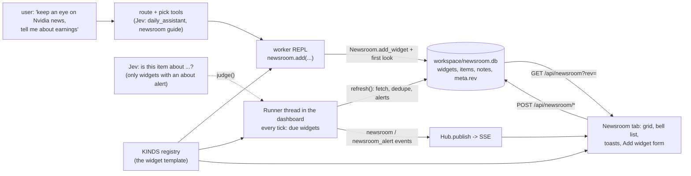

# 20. The Newsroom: widgets that follow things and notify the user

Status: built and tested offline (`tests/test_newsroom.py`, `test_newsroom_ui.py`, `test_newsroom_evals.py`; the page was driven in
Chromium against feeds served from localhost), and **partly verified live** on 2026-10-09 with `evals/newsroom_cases.py` and
`evals/bench/newsroom.py`: what held, what fell below its target and what could not be checked is in the status note of
[docs/newsroom.md](../newsroom.md), which is the user guide. No number in this page comes from a measurement.

## What it is

A **Newsroom** tab in the dashboard: a board of widgets. Each follows one source (X account, news search, RSS, subreddit, GitHub
releases, ...), keeps what it finds, looks again on a timer, and turns new items that match into **notifications**. The user
sets it up by asking in the chat; a tool does the rest.

## The parts

| Part | Where | Job |
|---|---|---|
| **KINDS** | `jevh/newsroom.py` (`Kind`, `Param`, `feed_kind`) | The template for a widget: name, settings, one `fetch(params) -> items` and a default title. The worker's guide, `newsroom.kinds()`, `jevh newsroom kinds`, the dashboard's Add form and parameter checks (`clean_params`) all come from it. A new source is one entry. |
| **Newsroom** | same | The SQLite store (WAL: the worker's REPL process and the dashboard both write) and the logic: `add_widget` (a duplicate returns the existing one), `refresh` (fetch, insert each item once, keep the newest `keep_items`, match alerts), `due` (timer, with backoff on failure), notifications. `meta.rev` goes up on every change by either process: it is how the page knows to redraw. |
| **Runner** | same | A daemon thread started in the dashboard's lifespan: every `tick` seconds, `refresh_due` on a few threads, then `on_alerts` / `on_change`. Without the dashboard nothing refreshes. |
| **`newsroom` tool** | `jevh/tools/newsroom.py` | What the worker's REPL imports: `add`, `company`, `widgets`, `items`, `edit`, `remove`, `refresh`, `notify`, `kinds`. `add` takes the widget's first look so the worker can say what it found. Its guide is in `jevh/tools/__init__.py` (`TOOLS["newsroom"]`), and Jev decides per task whether it goes into the prompt, like the other tools ([08](08-tools.md)). |
| **Server** | `jevh/web/server.py` | `GET /api/newsroom` (the board; with `rev` equal to the current one only `{unchanged}`), `POST /api/newsroom/add | update | delete | move | refresh | read | notes/read | notes/clear`. `Hub._judge_about` is Jev's judge. |
| **Page** | `jevh/web/static/index.html` (`// ---- newsroom`) | Grid of cards, per-card settings form generated from the kind's params, bell list, toasts, desktop notifications (Notification API, after a click), polling every 20 s plus an immediate refresh on `newsroom*` events and when a turn ends. |

## One look at one widget (`Newsroom.refresh`)

1. `KINDS[kind].fetch(params)` -> raw items (RSS/Atom through `parse_feed`; X through a feed bridge, an API token or Nango; `web` through
   `tools/web.search`). A failure is stored on the widget (`error`, `fails`), never raised; `due` waits twice as long per failure, up to 6 h.
2. Each item is cleaned (`_clean_item`: field caps, only `http(s)` links, a uid from the feed's id, else the link, else a hash of the title)
   and inserted `OR IGNORE` on `(widget_id, uid)`: an item is new once. A kind with `settle > 1` (`web`: a search engine's bottom
   places shuffle between identical searches) first holds an unseen item in `pending` and lets it in only when the next look still
   shows it (`Newsroom._settled`); an empty answer, which a rate-limited search sends, leaves `pending` as it was.
3. **The first successful look is the baseline**: its items are stored as read and cannot notify.
4. For the new items of a later look, `alert_matches(alert, item, judge, threshold)`: an `exclude` word vetoes; `all` notifies; a keyword
   (whole word at its start; 4+ letters may go on) notifies; otherwise, if the alert has `about` and a judge exists, Jev's P(yes) for
   `ABOUT_Q` over `{item, interest}` at/above `thresholds.newsroom_about` notifies. A judge that fails is "no match", not an error.
   At most 5 notifications per look, then one "and N more".

## Where it can go wrong (what the benches look for)

- Jev offering the guide for a one-off lookup (a widget for "what's the news on X?") or missing a request that doesn't say "track":
  `evals/newsroom_cases.py --stage tool`. The new `daily_assistant` description moving other requests: `--stage route`.
- An unstable item identity in a real feed (every look finds the same stories "new"): `evals/bench/newsroom.py --stage sources`, second look.
- A worker that never calls the tool, makes the wrong widget or says it did when the board is empty: `--stage turns` reads the board, not the answer.
- Keywords missing paraphrases (no word to match) and `about` over- or under-firing: `--stage about`, with a threshold sweep.
- X: three set-ups, none verified against a live X.

## Limits

Alerts reach the dashboard (page, toast, desktop notification) only: no email or phone push. Items are headline, link and a short
summary: the page is not a reader. A paused or failing widget keeps its old items. `about` costs one Jev question per new item of a widget
that has it. Looking happens in the dashboard process: close it and nothing refreshes.
