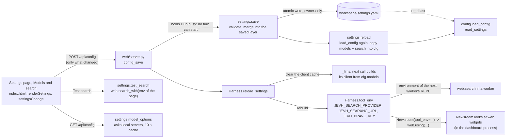

# 21. Settings: the few choices people change, saved as one more config layer

The **Models and search** section of the dashboard's **Settings** page changes the model, the quick model and the web search engine without editing YAML. This page is
what happens between the click and the next model call. User guide: [docs/dashboard.md](../dashboard.md#settings). Function names
are given instead of line numbers: search for them.

## The layer

`config.load_config` lays `<workspace>/settings.yaml` over `config.yaml`, `~/.jevh/config.yaml` and `config.local.yaml`, last, so a
choice made in the tab wins and those files, with their comments, are never rewritten. `read_settings` honours only the sections in
`SETTINGS_KEYS` (`models`, `search`), ignores a file it cannot read (a broken settings file must not stop the harness from
starting), and is skipped under `JEVH_NO_LOCAL_CONFIG` like the other machine-specific layers (the tests set it).

A `null` in the file removes what the files below it set: "each assistant's own" is `models.strong: null`, "off" is `models.fast:
null` (`merged` pops a key whose value is `None`; `Config.models` also drops a `null` tier, so nothing downstream ever sees one).
A model choice is stored as `{provider, model}` and merged *into* what the files say, so a `temperature` set in
`config.local.yaml` is kept.

## Saving and applying

`settings.save` validates everything before writing anything (a provider that is in the config, a model name that is a name, a
SearXNG address that is a URL, an engine that has what it needs) and raises `SettingsError` with what to change. The file is written
to a temp file and renamed, readable by the owner only (it can hold a Brave key; the page is never sent the key back, only whether
one is saved). `reload` re-reads the files into the live `Config`, **from the folder `save` wrote to** (`settings_dir=cfg.workspace`):
reading it from the folder the config files name worked until something moved `cfg.workspace` after loading, as every bench and test
fixture does, and then a save silently never took effect (found by the live check, `tests/test_settings.py`).

Only two things in a running dashboard depend on these choices, and `Harness.reload_settings` refreshes both:

- **Models.** `Harness._llm` builds a client per (persona, tier) from `cfg.models` and keeps it; reload clears that cache. A worker that
  is already running keeps its client, which is why the API refuses to save while a turn runs (it takes the same `Hub.busy` lock a
  turn takes). A dashboard started with `--model` ignores the two model choices, and the API says so.
- **Web search.** `web.search` is a dispatcher over `PROVIDERS` (DuckDuckGo, SearXNG, Brave). A worker's REPL gets the choice in its
  environment (`Harness.tool_env`, rebuilt by reload, so the next worker sees it); the Newsroom's web widgets run in the dashboard's
  own process, so they get it through `Newsroom(tool_env=...)` and `web.using(...)`, a context variable. An unset or unknown
  engine is an error with what to do, not a silent fallback; a search that cannot be made raises `SearchError` and `web.ask` passes
  the reason on in its `note`.

## What the tab lists

`model_options` asks each local OpenAI-style provider (`127.0.0.1` / `localhost` only: a cloud provider is never probed) at most every
10 seconds, with a 2 second timeout, in parallel: LM Studio's own `/api/v1/models` (its LLMs, and which are loaded), and `/v1/models`
for llama.cpp or vLLM. A model in force that no server lists is kept in the list as "(not listed)": llama.cpp serves one model and
ignores the name it is asked for, so a working name can be absent. Anything else is typed as `provider:model`.

## Verified, and not

Offline (`tests/test_settings.py`, `tests/test_settings_ui.py`): the layer, validation, the key never coming back, model discovery
against real local fake servers, the three engines against fake SearXNG and Brave servers, the API (including 409 while a turn
runs), a harness building its clients and workers from the new choices, the Newsroom looking with the chosen engine, and the page in
Chromium. Live (2026-10-09, your servers): the model lists come from LM Studio and llama.cpp; a real turn answered on the model saved in
the tab and went back after Reset; DuckDuckGo's Test search and the Newsroom web widget ran against the real DuckDuckGo. **Not**
verified live: SearXNG and Brave against real servers (no server or key here).
