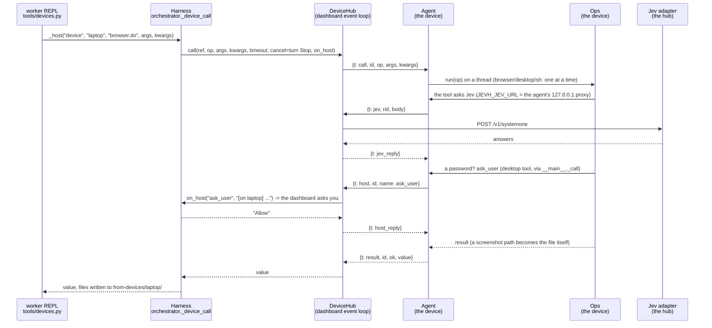

# 22 · Devices and sign-in

Other computers the worker can use (files, a shell, the screen, the browser and desktop tools), connected to the
dashboard, and the accounts that sign in to it from anywhere on the tailnet. User guide: [../devices.md](../devices.md).

Files: `jevh/accounts.py` (accounts, sign-in sessions, devices, pairing codes; `jevh users`), `jevh/devices/hub.py` (the
connections, a worker's call), `jevh/devices/agent.py` (the device's side; `jevh device`), `jevh/devices/ops.py` (what a
device does), `jevh/devices/wire.py` (the messages, files inside them), `jevh/tools/devices.py` (the worker's tool),
`jevh/app.py` (`jevh app`: window, tray, agent), `jevh/web/server.py` (the guard, `/login`, `/auth/*`, `/api/devices*`,
the WebSocket), `jevh/web/static/login.html`, the Devices section of the Settings page in `index.html`. Tests: `tests/test_devices.py`. Live:
`evals/devices_cases.py` (Jev's tool pick), `evals/bench/devices.py` (full turns).

## A call, end to end

## What decides what

| Decision | Who | Where |
|---|---|---|
| Does this task's prompt get the devices guide | Jev (`pick_tools`, the `tool` threshold), told which devices are connected | `Harness._pick_tools` |
| Does the worker have the tool at all | code: only while a device is online (else no import, no guide, no pointer line) | `Harness.run_task` |
| Which device, which operation | the worker (it names the device) | `tools/devices.py` |
| Each click and field on the device | Jev, as on the hub (the browser and desktop tools run there unchanged) | `ops.Ops.tool` |
| A shell command needs a yes | code: `ops.RISKY` (delete, kill, format, shutdown, force-push...) | `ops.Ops.sh` |
| Delete / overwrite | code: always undoable (trash/, backups/ on the device) | `ops.Ops._keep` |
| What a device may ask the hub | code: `look` and `ask_user` only (`hub.HOST_NAMES`); Jev on `/v1/systemone` and `/health` only | `hub.DeviceHub._answer_host/_answer_jev` |
| Who gets in from another device | code: a signed-in session (accounts exist) or the launch key (none yet) | `server.guard` |

## "This computer": where a message was written

`server.origin_of` names the computer each chat message came from. Not through `tailscale serve`: the hub (`"here"`).
Through it: the last `X-Forwarded-For` entry (the one tailscale appended; an earlier one could be the client's own), which
is the hub when it is one of `this_machine_ips()`, else the device whose WebSocket came from that address
(`DeviceHub.device_at`; `Link.ip` is recorded the same way when it connects), else `"elsewhere"` (a phone, or a computer
that is not connected). `Hub.start_turn` sets `Harness.origin`, and the turn record carries it for the page ("from
bilbo", "from another device").

When the origin is a connected device, `run_task` adds the devices guide whatever Jev picked (Jev judges the words alone;
"my Downloads" reads as a local request). Two lines then tell the worker where the user is: `_where_note` in the
Environment section, and `_devices_note` after the guide. The first exists because, told only in the guide, a worker
asked for "note.txt in my home folder" opened `~` with plain Python on the hub (live, 2026-10-12). From the hub the note
says "this computer" is the hub; with no origin it says what it said before.

The Environment line is there even when the worker can't reach the user's computer: from a phone or an unconnected
computer ("elsewhere") it says the user doesn't see this computer's screen, and for a persona without the devices tool it
says the user is on the device and nothing reaches it from here. Live (2026-10-12, flagged session 11): the hub ran with
persona files from before the devices tool, and asked "did you open that on bilbo or the hub? because im on bilbo", the
worker answered "Which one is DESKTOP-AUIDSM2?". With no device online `_devices_note` says so (it used to say
"Connected now: ."). Bench: `evals/bench/flagged.py --stage where`.

## Design facts

- **The device connects out.** Nothing listens on a device but a proxy on 127.0.0.1, so it needs no firewall rule and no
  address. The hub is already behind `tailscale serve` for the phone, and the WebSocket goes through the same front
  (`wss://<hub>:10000/api/devices/ws`).
- **The key is the WebSocket's sign-in.** It is a bearer header, which no web page can set on a WebSocket, so a page
  elsewhere cannot open a device connection with someone's cookie. A wrong or revoked key is accepted and then closed
  with code 4401. The agent stops trying on 4401, and retries any other close with backoff (2 s doubling to 60 s).
- **Jev stays on the hub.** The browser and desktop tools build their Jev client from `JEVH_JEV_URL`. On a device that
  is the agent's proxy, which forwards over the connection. So a device needs no Jev and no GPU, and its decisions use
  the same backend as the hub's.
- **The device's own tools, unchanged.** `ops.Ops.tool` imports `jevh.tools.browser` / `desktop` on the device and calls
  the function asked for (public functions only). A result's path to a file the tool made (a screenshot) is sent as
  the file, and the harness writes it into the task's folder.
- **Stop reaches the device.** `DeviceHub.call` waits with the turn's cancel event. On Stop it sends `cancel`, and a shell
  command there is killed. A browser or desktop step in progress finishes its current action. The call returns
  `Cancelled` at once.
- **One app per device process.** The agent sets `JEVH_JEV_URL` for its whole process, so it must not run inside a hub
  process: its workers would inherit it. The bench runs its device as its own `jevh device run` process for this
  reason.
- **The device folder is not `~/.jevh`.** Once `~/.jevh` exists the harness reads personas and skills from it and writes
  learned skills there. A device creating it would change how a hub on the same machine behaves. Device state is in
  `~/.jevh-device` (`JEVH_DEVICE_HOME`).
- **Sign-in replaces the key link.** With no accounts, nothing changes: the per-launch `?key=` link and its cookie. Once
  an account exists, a remote host needs a `jevh_session` cookie (HttpOnly, Secure, SameSite=Lax, 30 days). Lax rather
  than Strict, so that opening the hub from a link in another app keeps you signed in. The API token and the Origin check
  still guard every POST.
- **The phone tab bar scrolls.** Eleven tabs need about 400 px. Shrunk to fit 360 px, the last one slid under the
  Appearance button (caught by `tests/test_dashboard_ui.py`). The tabs now keep 34 px and scroll sideways on their own.
