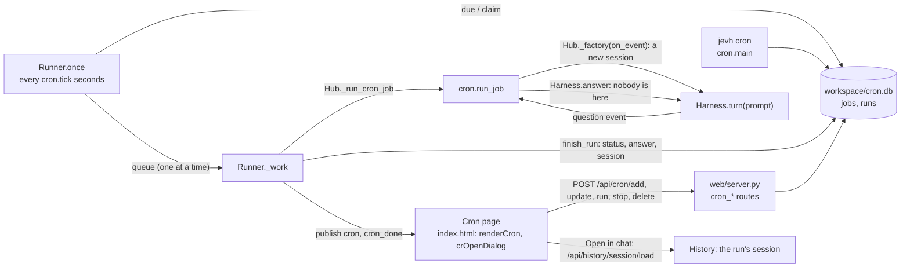

# 23. Cron jobs: tasks done on a schedule

The dashboard's **Cron** page lists jobs: a request ("summarize my unread mail") and a schedule ("weekdays at 8:30"). The dashboard
starts each one when its time comes, as a turn of its own, and keeps what it did. This page is what happens between the schedule
and the answer. Source: [jevh/cron.py](../../jevh/cron.py). Function names are given instead of line numbers: search for them.

**Status: unverified on live models.** The offline tests (`tests/test_cron.py`, `tests/test_cron_ui.py`) pass; the live bench
`evals/bench/cron.py` is the check that counts (see "Checking it" below).

## The schedule

A schedule is stored as a five-field cron expression in local time. `from_text` also reads phrases (`every 15 minutes`, `weekdays at 8:30`,
`every monday and wednesday at 9`, `monthly on the 1st at noon`, `@daily`); a phrase with no time of day means 9 in the morning
(`nightly` is midnight). `CronExpr.next_after` finds the next minute the expression allows, walking month, day, hour and minute, and
follows cron's rule that a day-of-month and a day-of-week that are both given mean *either*. `describe` puts an expression back
in words for the page, and shows an unusual one as it is. `check` is what every save goes through: it refuses what is not a
schedule, what never runs (February 30) and what repeats faster than `cron.min_minutes`, with a sentence the page shows as typed
(`POST /api/cron/check`, called while the dialog is open).

## What is stored

`workspace/cron.db` (SQLite, WAL, shared by every process on the workspace):

| Table | Holds |
|---|---|
| `jobs` | name, request (`prompt`), `schedule`, the assistant it is pinned to (or none: Jev routes it as for any request), `enabled`, `next_run` |
| `runs` | per run: why it ran (`schedule` or `manual`), when due, started and finished, `status`, the `session` it ran in, the answer (cut at 6000 characters; the session has all of it), an error, a `beat` |

A run is `queued`, `running`, then `ok`, `error` (the worker could not do it, it raised, or it was stopped for running past
`cron.timeout_minutes`), `cancelled` (Stop, or the job was deleted), or `interrupted` (see below). A run that never started is `missed`
or `skipped`. `keep_runs` per job are kept.

## The timer

`Runner.once` runs every `cron.tick` seconds in the dashboard (started with the app, like the Newsroom's). For each enabled job whose
`next_run` has passed:

- **Waits while you work.** `ready()` is "no turn of yours is running" (`Hub.busy`). A job that is due while you are mid-turn is left alone and tried again at the next tick,
  until it is `cron.grace_minutes` late.
- **Missed, not made up.** A job later than that (the dashboard was off, or you were busy all that time) gets one `missed` run and moves on to its next time. A job due every
  morning that finds the dashboard off at 8:30 should not run at noon.
- **Claimed.** `CronJobs.claim` moves `next_run` on with `UPDATE ... WHERE next_run = <what was read>`: of two dashboards on one workspace (the phone dashboard and the app
  hub are both running here), only the one whose update changed a row starts the run.
- **Skipped.** A job whose previous run is still going is recorded `skipped` for that time.
- **One at a time.** Started jobs go in a queue and a single worker thread runs them in order: a local model serves one task well, not several.

`run_now` (the Run now button) queues a run by hand and leaves the schedule alone. `stop_run` sets the run's Stop event.

Each tick also refreshes a `beat` on this process's runs, and `reap` ends as `interrupted` any run whose beat is older than three
minutes: the dashboard that owned it was closed or crashed. With no dashboard running nothing starts; `jevh cron run <id>` runs one job by hand.

## One run

`run_job` builds a **new Harness** with `Hub._factory`, so a run has a session of its own: it neither reads nor disturbs the chat, appears in History, and is
reviewable like any session. It sees what any new session sees (memory, skills, its assistant's tools), plus the user's devices.
Then `Harness.turn(prompt, force=persona)`.

Nobody is there to answer: a `question` event from the worker is answered at once with "nobody is here to answer: use your best judgement,
or finish and say what you need" (`NOBODY`). Stop sets an event a watcher thread turns into `Harness.cancel`; a timer does the same after
`cron.timeout_minutes` and marks the run an error. `run_job` never raises: a harness that cannot be built, or a turn that crashes, is an `error` run.

Events (`cron`, `cron_done`) go to the page, which shows a toast and a count on the rail button for runs you have not looked at.

## What this does not do

- It does not run while the dashboard is off, and does not catch up after.
- It does not notify you outside the dashboard (no push, no e-mail).
- Jobs are created on the page or with `jevh cron`. Asking for one in the chat ("every morning, ...") is not built: a worker tool like `newsroom` would be the way.
- A job's tools run unattended: an assistant with the `desktop` or `devices` tool can act on your computers with nobody watching. Pin a job to a conservative assistant, and read its first runs.

## Checking it

| What | How |
|---|---|
| Schedules, store, runner decisions, a real harness with scripted models, the API, the CLI | `python -m pytest tests/test_cron.py -q` |
| The page in a real browser | `python -m pytest tests/test_cron_ui.py -q` |
| Live models | `python evals/bench/cron.py` (`--repeat`, `--holdout`, `--stage jobs\|timer`, `--offline`) |

The bench's thresholds are guesses until it has been run and read; it says which result would mean the feature is wrong.
