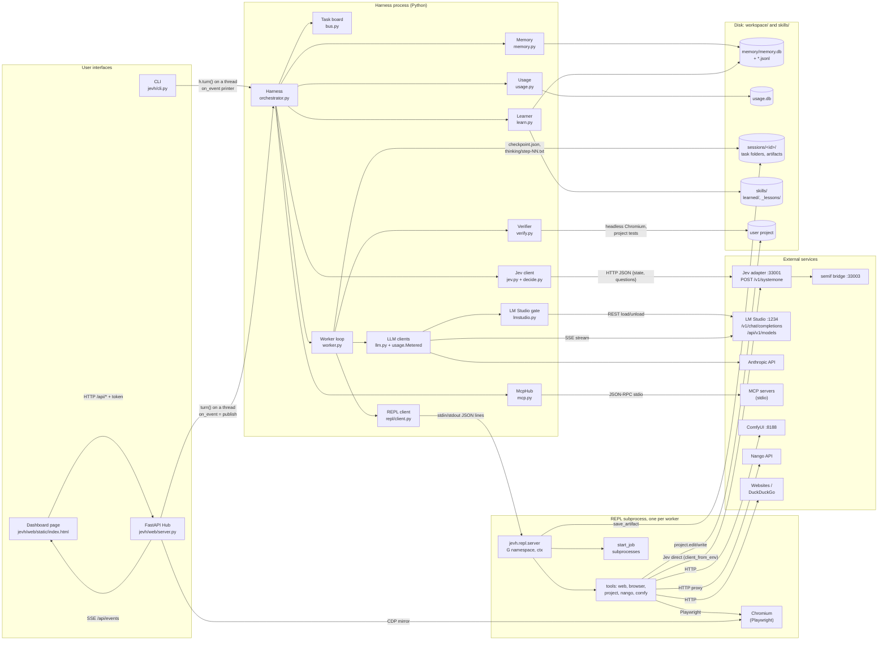
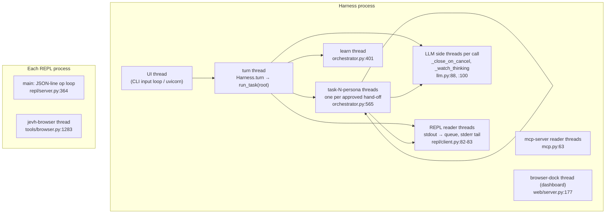

# Jev Harness architecture

These pages map every part of the harness and show what data crosses between its loops. Each
diagram is Mermaid (GitHub renders it), and every arrow names the function that sends the data
as `file:line`. Line numbers are for commit `df56020`. If they drift, search for the function
name.

| Page | What it covers |
|---|---|
| [README](README.md) (this page) | System map: processes, threads, transports, and where state lives on disk |
| [01 Turn and task setup](01-turn.md) | `Harness.turn` → routing → task board → `run_task`: how the worker's prompt and `ctx` are built |
| [02 Jev decisions](02-jev-decisions.md) | Every call to Jev: step name, state sent, questions asked, thresholds, fallback |
| [03 Worker step loop and REPL](03-worker-loop.md) | `Worker.run`: model reply → parse → REPL exec → callbacks → next message |
| [04 Model calls](04-llm-streaming.md) | Streaming, the watcher thread, silent-server retries, LM Studio's one-model gate, metering |
| [05 Stamina](05-stamina.md) | Compaction, progress check, thinking watch, step and error notes, checkpoint and resume |
| [06 Hand-offs](06-handoffs.md) | `request` / `request_async` / `wait`: the board, Jev's approval, threads and Futures |
| [07 The final() gate](07-final-gate.md) | File, render, project-test, risk-review and answer checks; bounce and escalate |
| [08 Tools](08-tools.md) | browser, web, project (+ rule enforcer), nango, comfy, MCP: their own Jev loops |
| [09 Memory and learning](09-memory-learning.md) | Storage, candidates, the memory gate, recall, follow-ups, facts and skills after a turn |
| [10 Control and observability](10-observability.md) | Stop, ask_user, the event bus, usage.db, the dashboard, and where to watch every part live |

## The one idea everything follows

Jev (a small System One model behind `/v1/systemone`) decides **what a worker model gets to
see**. The worker (any LLM) sees only its persona, the REPL guide, and what Jev let through. It
acts by writing Python in its own REPL process. Most of the harness is loops that feed Jev a
small typed question (`noul` = yes/no probability, `choice` = distribution, `score` = level) and
act on the answer with a tuned threshold.

## System map: processes and transports

Two paths to Jev are easy to miss:

- The harness asks Jev through `Jev._ask` (`jev.py:156`). Every one of these calls is recorded in
  `jev.trace` and in `usage.db` as kind `jev`.
- The tool modules inside the REPL (browser, web, project.find, the rule enforcer) build their own
  `SystemOneClient` from environment variables the harness set (`JEVH_JEV_URL`,
  `JEVH_JEV_BACKEND`, `JEVH_TOOLS_JEV`; `orchestrator.py:198-204`, `tools/_pick.py:19`). They talk
  to the adapter directly, not through the harness. After each exec the REPL reports how many
  calls they made (`repl/server.py:394-400`), and the harness records that as kind `jev_tools`
  (`orchestrator.py:582`).

A worker's own `jev(state, questions)` helper is different again: it goes back to the harness
over the REPL's callback channel and becomes a `worker_jev` step (`orchestrator.py:460`).

## Threads

The Harness uses a `threading.local` (`self._tl`, `orchestrator.py:208`) so any thread knows
which turn, task and persona it works for, and whether it's doing `llm` or `learn` work. Every
usage row and model call is tagged from it (`_where`, `orchestrator.py:569`).

## Where state lives

| State | Where | Written by | Read by |
|---|---|---|---|
| Conversation turns (full-text indexed) | `workspace/memory/memory.db` table `turns` + `turns_fts` | `Memory.append` (`memory.py:111`) after a successful turn | candidates, `recall`, follow-ups |
| What a turn's answer was based on | `memory.db` table `turn_notes` | `turn_notes()` (`orchestrator.py:76`) via `Memory.append` | follow-up history (`session_turns`) |
| Remembered facts | `memory.db` tables `facts` + `facts_fts` | Learner, `remember()` | candidates, `recall` |
| Human-readable logs | `workspace/memory/<persona>.jsonl`, `timeline.jsonl` | `Memory.append` | you |
| Every model, Jev and swap cost | `workspace/usage.db` table `usage` | `Harness._record` (`orchestrator.py:573`) | CLI footer, `/usage`, dashboard Usage tab |
| A task's working folder | `workspace/sessions/<session>/u<turn>t<task>-<persona>/` | the worker's REPL (its cwd) | the worker, `_harvest` |
| Worker conversation after each step | `…/checkpoint.json` | `Worker._save` (`worker.py:940`) | `resume` |
| REPL variables, imports, defs | `…/repl_state.pkl` | `repl.snapshot` (`repl/server.py:279`) | `repl.restore` on resume |
| Each step's live reasoning and reply | `…/thinking/step-NN.txt` | `_LiveFeed` (`llm.py:139`) | dashboard `/api/thinking`, you |
| Background job logs | `…/.jobs/<id>.log` | `start_job` (`repl/server.py:102`) | `job_status` |
| Originals of edited project files | `…/.project_backups/` | `project._backup` (`tools/project.py:162`) | `project.undo`, the gate's review diffs |
| Deliverables | `workspace/sessions/<session>/artifacts/` | `save_artifact`, `_resolve_artifact`, `_harvest` | the gate, the user, other workers (`inputs=`) |
| Docked browser ports | `workspace/sessions/<session>/browsers/<pid>.json` | browser `Session` (`tools/browser.py:440`) | dashboard BrowserDock |
| Learned skills and lessons | `skills/learned/learned-*/SKILL.md`, `skills/_lessons/<name>.md` | Learner | `load_roster` (next turn) |
| Config | `config.yaml` + `config.local.yaml` | you | `load_config` (`config.py:73`) |

## Glossary

- **Turn**: one user message and its answer. **Task**: one persona's job inside a turn. The
  root task comes from the user; others are hand-offs. **Step**: one model reply and what ran.
- **noul / choice / score**: Jev's three question types (`decide.py:22-39`). A noul returns P(yes).
  A choice returns a probability per option (semif takes 2 to 16 options per choice). A score rates
  along 2 to 10 ordered levels.
- **Tier**: `fast` (config `models.fast`) or `strong` (the persona's own model), picked per task.
- **Bounce**: the final() gate sends an answer back to the worker with problems to fix.
